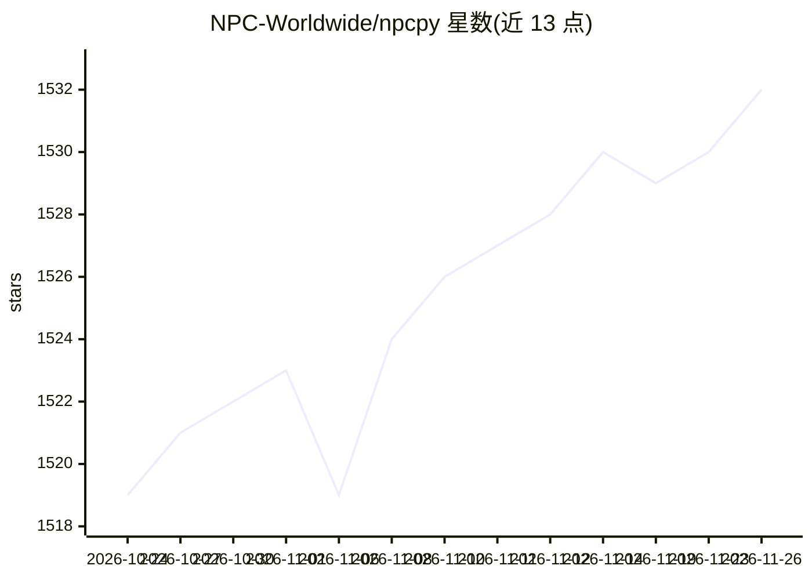

# NPC-Worldwide/npcpy

⭐ 1,532 · Python · MIT · 推送 2026-11-25 · [GitHub](https://github.com/NPC-Worldwide/npcpy) · 组织维护

**Python 库：构建多智能体、LLM 应用与知识图谱的原语集合**

npcpy 是面向多模态语言模型、智能体 AI 与知识图谱研发的 Python 库，提供 NPC 人格、Agent/ToolAgent/CodingAgent、多智能体团队（NPCArray、Team）等原语，并带有睡眠/做梦生命周期的知识图谱模块。支持本地（llama.cpp、LM Studio、ollama、omlx）与云端提供商调用，提供统一的决定型输出接口（choice/score/predict）、JSON/Pydantic 结构化输出、流式解析、图像/音频/视频生成，以及基于 .npc/.jinx/team.ctx 文件和 MCP 服务器的团队编排与 Flask 服务。

## 筛选速览

| 维度 | 判定 | 备注 |
|---|---|---|
| AI 角色 | `ai-ecosystem` | LLM/agent 周边工具 |
| 许可风险 | `permissive` | MIT |
| 部署形态 | `library` | 以包/库形式分发 |
| 模型依赖 | local-ok | 支持本地模型 |
| 硬件要求 | — | 无带数字的原话,不猜 |
| 安装摩擦 | `medium` | 含编译或系统依赖之一 |
| 成熟度 | — | 结构信号不足 |

## 能力要点

- NPC/Agent/ToolAgent/CodingAgent 与多智能体团队编排原语
- 统一 decision 接口（choice/noul/score/predict），本地 Ollama 后端无需 API key
- 带唤醒/睡眠/做梦生命周期的知识图谱构建与混合检索
- .npc/.jinx/team.ctx 文件格式团队定义与 MCP 服务器集成

## 适用场景

- 为研究和开发搭建多智能体协作与辩论流程
- 用本地模型快速试验无 API key 的决策型输出
- 从文本构建并持续演化知识图谱
- 通过 MCP 服务器为 NPC 团队接入外部工具与后端服务

## 场景标签

`多智能体` `知识图谱` · 领域:Agent 开发

## 证据(README 行号)

> L10: `npcpy` is a library that provides key primitives for research and development with multimodal language models, age
> L116: The `Agent` class in `npcpy` comes with a set of default tools (sh, python, edit_file, web_search, etc.)

## 星数曲线

2026-10-24 1,519 → 2026-11-26 1,532（+13）

---
*卡片 v1 · prompt 1.4 · 生成 2026-11-26 · 置信度 high · 依据 README sha `60bf8a3f0eb8` · [字段定义](../../DATASET.md)*
