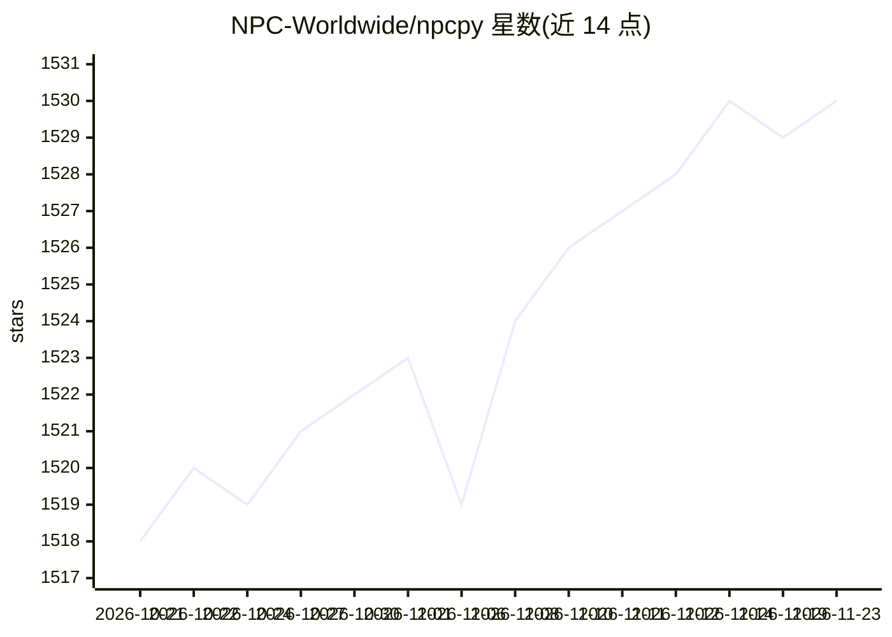

# NPC-Worldwide/npcpy

⭐ 1,530 · Python · MIT · 推送 2026-11-22 · [GitHub](https://github.com/NPC-Worldwide/npcpy) · 组织维护

**多模态 LLM、Agent 与知识图谱研发的 Python 库**

npcpy 提供面向多模态语言模型、Agent 与知识图谱开发的 Python 原语：支持本地（llama.cpp/LM Studio/ollama/omlx）与云端的 LLM 调用，NPC/Agent/ToolAgent/CodingAgent 类构建带工具的代理，NPCArray 做多代理辩论与并行执行，Team 支持 .npc/.jinx/team.ctx 文件定义与 MCP 服务器接入，知识图谱模块提供唤醒/睡眠/梦境生命周期与混合搜索，另有决策模型接口（choice/score/predict）与图像、音频、视频生成函数。通过 pip 安装，可经 Flask 服务化 NPC 团队。

## 筛选速览

| 维度 | 判定 | 备注 |
|---|---|---|
| AI 角色 | `ai-ecosystem` | LLM/agent 周边工具 |
| 许可风险 | `permissive` | MIT |
| 部署形态 | `library` | 以包/库形式分发 |
| 模型依赖 | local-ok | 支持本地模型 |
| 硬件要求 | — | 无带数字的原话,不猜 |
| 安装摩擦 | `medium` | 含编译或系统依赖之一 |
| 成熟度 | — | 结构信号不足 |

## 能力要点

- 统一的 get_llm_response 接口支持本地与云端多 provider
- NPC/Agent/ToolAgent/CodingAgent 与多代理团队编排（.npc/.jinx/team.ctx 文件格式）
- 知识图谱构建、演化与睡眠/梦境巩固机制
- MCP 服务器集成与 Pydantic/JSON 结构化输出

## 适用场景

- 为多模态 LLM 应用构建带自定义工具的代理
- 搭建多代理团队并接入 MCP 外部工具
- 从文本构建并演化知识图谱、抽取结构化记忆
- 以决策模型接口获取可阈值化的标签/评分输出

## 场景标签

`知识图谱` `Agent 框架` `编码 Agent` `多智能体` · 领域:Agent 开发

## 证据(README 行号)

> L10: `npcpy` is a library that provides key primitives for research and development with multimodal language models, age
> L116: The `Agent` class in `npcpy` comes with a set of default tools (sh, python, edit_file, web_search, etc.)
> L419:  Knowledge graphs

## 星数曲线

2026-10-21 1,518 → 2026-11-23 1,530（+12）

---
*卡片 v1 · prompt 1.4 · 生成 2026-11-23 · 置信度 high · 依据 README sha `e5c368c03e47` · [字段定义](../../DATASET.md)*
