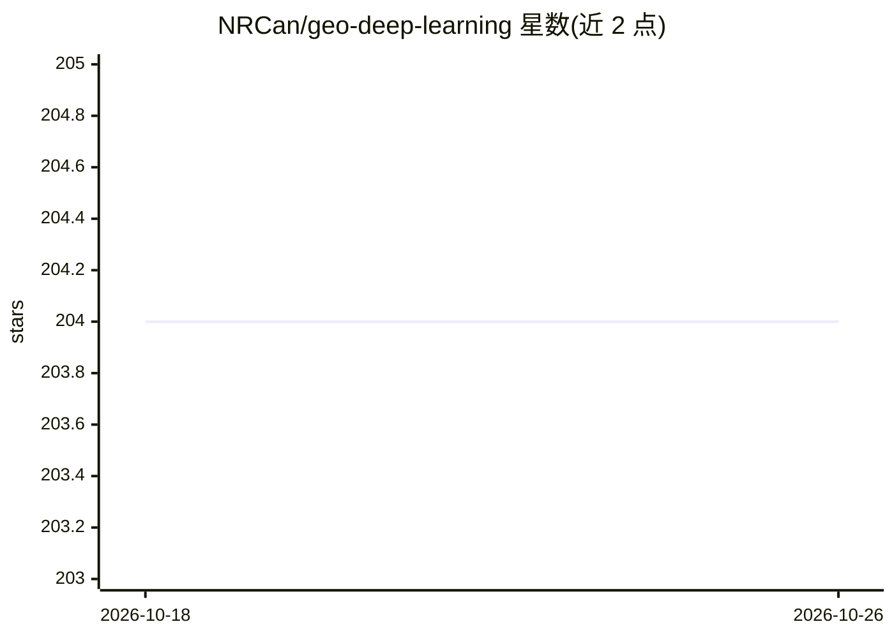

# NRCan/geo-deep-learning

⭐ 204 · Jupyter Notebook · MIT · 推送 2026-10-16 · [GitHub](https://github.com/NRCan/geo-deep-learning) · [官网](https://github.com/NRCan/geo-deep-learning/tree/main?tab=readme-ov-file#readme) · 组织维护

**面向遥感地学数据的 PyTorch Lightning 深度学习训练框架**

加拿大自然资源部（NRCan）维护的地理空间深度学习框架：基于 PyTorch Lightning，支持多传感器地球观测数据的语义分割、目标检测与回归任务。采用编码器-颈部-解码器模块化架构，内置 UNet++、SegFormer、DOFA 基础模型，支持 WebDataset 分片数据加载、多 GPU 分布式训练、混合精度、MLflow 实验跟踪。通过 uv 包管理器安装，提供 CPU 与 CUDA 12.8 两套隔离锁文件环境。

## 筛选速览

| 维度 | 判定 | 备注 |
|---|---|---|
| AI 角色 | `ai-native` | 本体是模型或模型工具 |
| 许可风险 | `permissive` | MIT |
| 部署形态 | `None` |  |
| 模型依赖 | — | README 未给出锁定关系 |
| 硬件要求 | `cpu-ok` | |
| 安装摩擦 | `medium` | 含编译或系统依赖之一 |
| 成熟度 | — | 结构信号不足 |

## 能力要点

- 多传感器地球观测数据同时训练（传感器混合）
- 内置 UNet++、SegFormer、DOFA（Base/Large）模型
- WebDataset 分片存储加载与多 GPU 分布式训练
- CPU 与 CUDA 12.8 双锁文件环境，可复现安装

## 适用场景

- 用多源遥感影像训练语义分割/检测/回归模型
- 在 GPU 集群上做大规模地理空间模型训练与实验跟踪
- 复用 DOFA 基础模型做波长相关的多尺度特征提取

## 场景标签

`模型训练` · 领域:训练与推理

## 证据(README 行号)

> L7: Geo Deep Learning (GDL) is a modular framework designed to support a wide range of geospatial deep learning tasks su
> L15: - **Multiple Model Types**: UNet++, SegFormer, DOFA (Dynamic-one-for-all Architecture).

## 星数曲线

2026-10-18 204 → 2026-10-26 204（+0）

---
*卡片 v1 · prompt 1.4 · 生成 2026-10-22 · 置信度 high · 依据 README sha `01e267cddade` · [字段定义](../../DATASET.md)*
