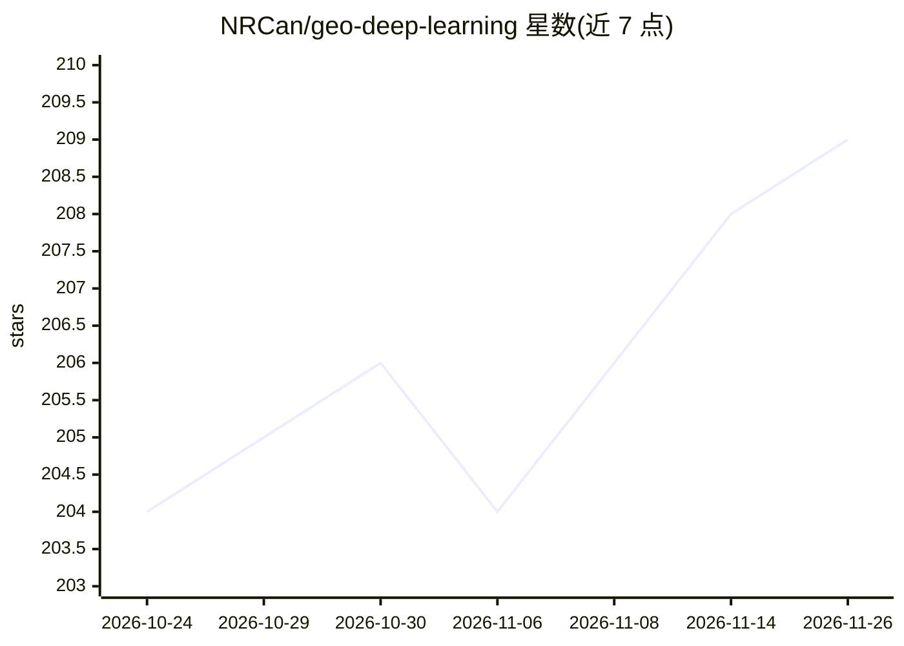

# NRCan/geo-deep-learning

⭐ 209 · Jupyter Notebook · MIT · 推送 2026-11-18 · [GitHub](https://github.com/NRCan/geo-deep-learning) · [官网](https://github.com/NRCan/geo-deep-learning/tree/main?tab=readme-ov-file#readme) · 组织维护

**地球观测数据的地理空间深度学习训练框架**

基于 PyTorch Lightning 的模块化地理空间深度学习框架，支持语义分割、目标检测与回归任务。提供 UNet++、SegFormer、DOFA 等模型实现，支持多传感器地球观测数据混训、WebDataset 分片加载、多 GPU 分布式训练、混合精度与 MLflow 实验跟踪。安装采用 uv 包管理器，通过 CPU 与 CUDA 12.8 两套独立 lockfile 实现环境复现，配置经由 YAML 文件。

## 筛选速览

| 维度 | 判定 | 备注 |
|---|---|---|
| AI 角色 | `ai-native` | 本体是模型或模型工具 |
| 许可风险 | `permissive` | MIT |
| 部署形态 | `None` |  |
| 模型依赖 | — | README 未给出锁定关系 |
| 硬件要求 | `cpu-ok` | |
| 安装摩擦 | `medium` | 含编译或系统依赖之一 |
| 成熟度 | — | 结构信号不足 |

## 能力要点

- 支持语义分割、目标检测与回归三类地理空间任务
- UNet++、SegFormer、DOFA 三类模型与可互换编码器-neck-解码器架构
- 多传感器数据混合训练与 WebDataset 分片加载
- 多 GPU 分布式训练、混合精度与 MLflow 跟踪

## 适用场景

- 对遥感影像做语义分割模型训练
- 融合多个地球观测传感器数据进行训练
- 用 MLflow 记录和版本管理遥感模型实验

## 场景标签

`目标检测` `模型训练` · 领域:感知与多模态

## 证据(README 行号)

> L5: A PyTorch Lightning-based framework for geospatial deep learning with multi-sensor Earth observation data.
> L9: Geo Deep Learning (GDL) is a modular framework designed to support a wide range of geospatial deep learning tasks su
> L10: Built on PyTorch Lightning, it provides efficient training pipelines for multi-sensor data.

## 星数曲线

2026-10-24 204 → 2026-11-26 209（+5）

---
*卡片 v1 · prompt 1.4 · 生成 2026-11-25 · 置信度 high · 依据 README sha `b65a8892193e` · [字段定义](../../DATASET.md)*
