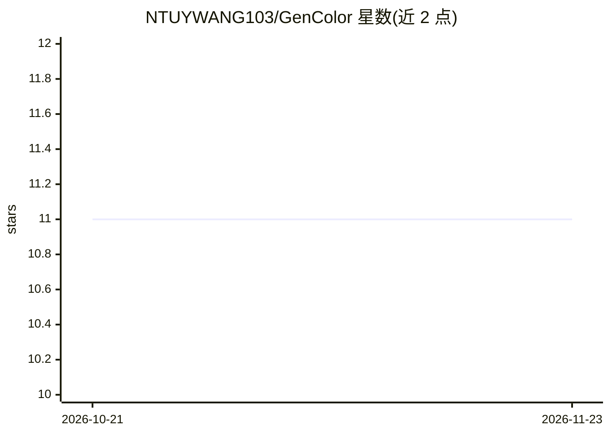

# NTUYWANG103/GenColor

⭐ 11 · Jupyter Notebook · 推送 2026-01-23 · [GitHub](https://github.com/NTUYWANG103/GenColor) · 组织维护

**图像颜色增强模型的 PyTorch 官方实现（NeurIPS 2025）**

论文 GenColor 的官方 PyTorch 代码库，实现生成式颜色增强并保持纹理像素级不变。提供推理 demo 脚本与 fusion notebook，以及 ComfyUI 自定义节点集成（GenColor Fusion）。因商业化与版权考虑，仅发布 stage 2 纹理保持网络，stage 1 颜色增强模型待发布；训练部分提供 ARTISAN-1.2M 数据集 240P 预览版及基于 BLIP/Qwen3-VL 的 caption 生成流程。

## 筛选速览

| 维度 | 判定 | 备注 |
|---|---|---|
| AI 角色 | `ai-native` | 本体是模型或模型工具 |
| 许可风险 | `none` | — |
| 部署形态 | `library` | 以包/库形式分发 |
| 模型依赖 | — | README 未给出锁定关系 |
| 硬件要求 | — | 无带数字的原话,不猜 |
| 安装摩擦 | `low` | 无编译、无系统依赖或容器化 |
| 成熟度 | — | 结构信号不足 |

## 能力要点

- 单图颜色增强 demo 脚本与 fusion notebook
- ComfyUI 自定义节点集成
- 提供 ARTISAN-1.2M 数据集 240P 预览版与 caption 生成流程（BLIP/Qwen3-VL）

## 适用场景

- 对照片进行颜色增强且要求纹理像素级保持
- 在 ComfyUI 工作流中接入颜色增强节点
- 复现论文训练流程

## 场景标签

`图像视频处理` · 领域:感知与多模态

## 证据(README 行号)

> L5: Official PyTorch Implementation of NeurIPS 2025 (Spotlight) Paper "GenColor: Generative and Expressive Color Enhance
> L26: ### Single image enhancement demo script

## 星数曲线

2026-10-21 11 → 2026-11-23 11（+0）

---
*卡片 v1 · prompt 1.4 · 生成 2026-11-19 · 置信度 high · 依据 README sha `7b8398347fa3` · [字段定义](../../DATASET.md)*
