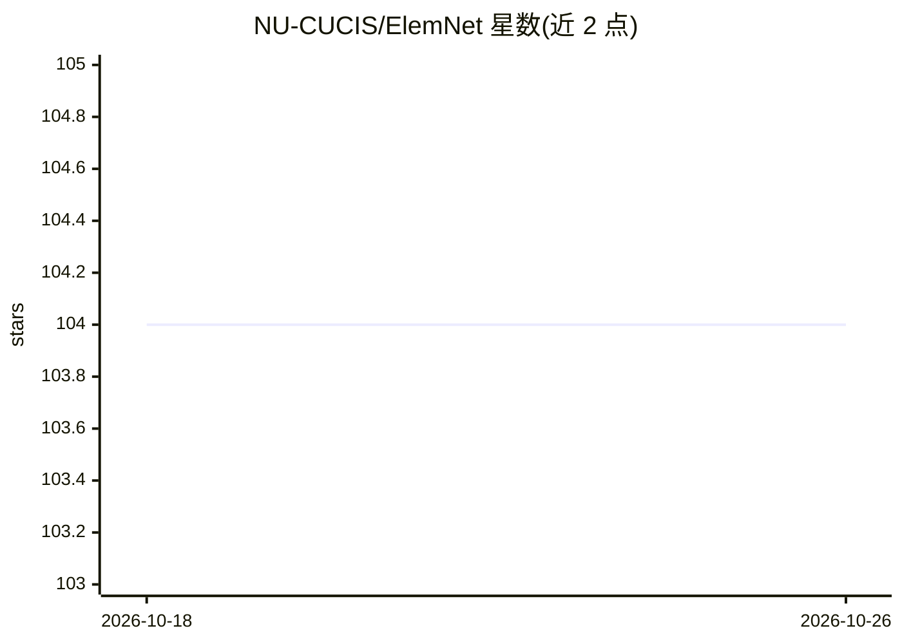

# NU-CUCIS/ElemNet

⭐ 104 · Jupyter Notebook · NOASSERTION · 推送 2026-01-13 · [GitHub](https://github.com/NU-CUCIS/ElemNet) · 组织维护

**仅凭元素组成预测材料性质的深度神经网络模型**

西北大学 CUCIS 组开发的深度神经网络模型 ElemNet：仅以化学元素组成为输入，自动学习元素间化学交互与相似性，预测材料性质，并可绘制训练集中未出现化学体系的相图。仓库包含数据处理、模型训练与分析脚本及预训练模型；支持从零训练（如 OQMD 大数据集）与基于预训练模型的迁移学习。运行需要 Python 3.6.3 的 Jupyter 环境与 requirements.txt 所列包，部分分析需 Java JDK 1.7+（Magpie）。通过配置文件传入 dl_regressors.py 运行。

## 筛选速览

| 维度 | 判定 | 备注 |
|---|---|---|
| AI 角色 | `ai-native` | 本体是模型或模型工具 |
| 许可风险 | `none` | NOASSERTION |
| 部署形态 | `None` |  |
| 模型依赖 | — | README 未给出锁定关系 |
| 硬件要求 | — | 无带数字的原话,不猜 |
| 安装摩擦 | `medium` | 含编译或系统依赖之一 |
| 成熟度 | — | 结构信号不足 |

## 能力要点

- 仅以元素组成为输入预测材料性质，无需物理属性特征工程
- 支持从零训练与基于预训练模型的迁移学习
- 包含预训练模型与多个数据集（OQMD/JARVIS/Materials Project/实验数据）
- 提供层激活分析用于解释模型学到的化学规律

## 适用场景

- 用大数据库（如 OQMD）从零训练材料性质预测模型
- 在小规模 DFT 或实验数据上用迁移学习预测材料性质
- 预测训练集中未包含的化学体系相图

## 场景标签

 · 领域:材料科学/机器学习

## 证据(README 行号)

> L3: ElemNet is a deep neural network model that takes only the elemental compositions as inputs and leverages artificial
> L5: This repository contains the code for performing data processing, model training and analysis along with the trained

## 星数曲线

2026-10-18 104 → 2026-10-26 104（+0）

---
*卡片 v1 · prompt 1.4 · 生成 2026-10-23 · 置信度 high · 依据 README sha `74ff8f2b6987` · [字段定义](../../DATASET.md)*
