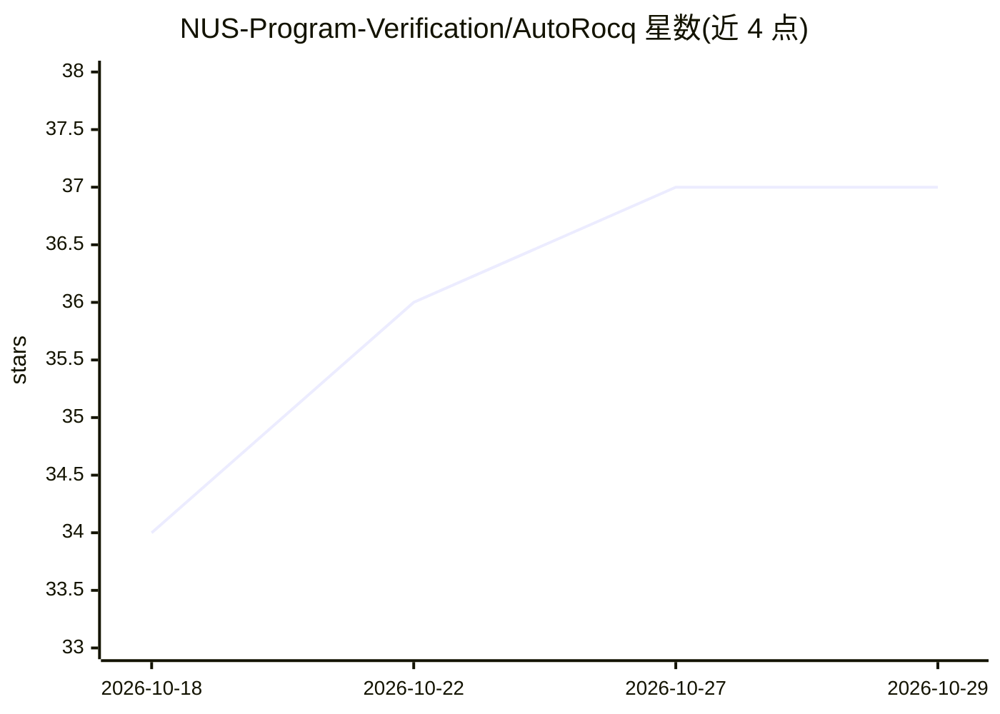

# NUS-Program-Verification/AutoRocq

⭐ 37 · Python · NOASSERTION · 推送 2026-10-26 · [GitHub](https://github.com/NUS-Program-Verification/AutoRocq) · 组织维护

**LLM 驱动的 Rocq 定理证明 agent，用于程序验证**

AutoRocq 是运行于 Rocq（原 Coq）9.0.0 之上的 agent 定理证明器：LLM 通过 CoqPyt 与 Rocq 交互，在 plan/tactic/context_search 工具循环中自动生成证明脚本，并在一次性副本上运行以保持原文件不变。支持 LiteLLM 接入多种模型、交互式 REPL 模式（用户可注入提示、直接施加 tactic、回滚与查看证明树）。附带 AutoRocq-bench 基准（SV-COMP 641 条与 Linux 内核断言 60 条定理），论文投往 FSE 2026。本地安装需 Python 依赖与 opam 依赖，另提供 Docker 镜像。

## 筛选速览

| 维度 | 判定 | 备注 |
|---|---|---|
| AI 角色 | `ai-native` | 本体是模型或模型工具 |
| 许可风险 | `none` | NOASSERTION |
| 部署形态 | `self-host` | docker 或自建部署 |
| 模型依赖 | — | README 未给出锁定关系 |
| 硬件要求 | — | 无带数字的原话,不猜 |
| 安装摩擦 | `low` | 无编译、无系统依赖或容器化 |
| 成熟度 | — | 结构信号不足 |

## 能力要点

- LLM agent 循环（plan/tactic/context_search）自动生成 Rocq 证明
- 通过 LiteLLM 支持多种模型接入
- 交互式 REPL：可注入自然语言 hint、直接施加 tactic、回滚与查看证明树
- AutoRocq-bench：来自真实 C 代码的 641+60 条验证定理基准

## 适用场景

- 自动证明 Rocq/Coq 中形式化陈述的验证定理
- 与 agent 协作共同开发证明（交互模式）
- 在 SV-COMP/Linux 内核提取的验证任务上评测证明能力

## 场景标签

 · 领域:形式化验证/定理证明

## 证据(README 行号)

> L7: This repository contains the source code of AutoRocq, an agent prover in Rocq (formerly Coq) 9.0.0.
> L18: where the LLM interacts with the Rocq proof assistant (via CoqPyt) in real time to develop a proof.

## 星数曲线

2026-10-18 34 → 2026-10-29 37（+3）

---
*卡片 v1 · prompt 1.4 · 生成 2026-10-25 · 置信度 mid · 依据 README sha `5bf764250610` · [字段定义](../../DATASET.md)*
