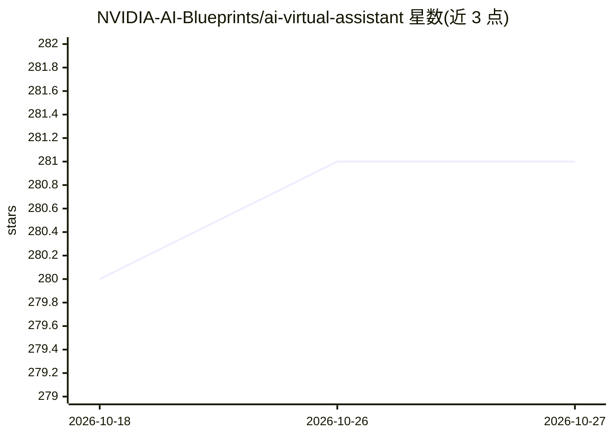

# NVIDIA-AI-Blueprints/ai-virtual-assistant

⭐ 281 · Python · Apache-2.0 · 推送 2026-10-14 · [GitHub](https://github.com/NVIDIA-AI-Blueprints/ai-virtual-assistant) · [官网](https://build.nvidia.com/nvidia/ai-virtual-assistant-for-customer-service) · 组织维护

**面向客服的 AI 虚拟助手参考蓝图（NVIDIA NIM + RAG）**

NVIDIA AI Blueprint 系列的客服虚拟助手参考方案：基于 NIM 微服务（Llama 3.3 70B 推理、嵌入与重排）、NeMo Retriever 与 RAG，提供多轮上下文对话、基于结构化（Postgres 订单/客户数据）与非结构化（PDF 手册/FAQ，经 Milvus 向量库）数据的个性化问答、情感分析与会话摘要，并含反馈数据飞轮 API。编排采用 LangGraph 三个子代理，通过 Docker Compose 单机或 Helm/Kubernetes 部署，面向希望快速上手 NIM 的 IT 工程师。注意：项目已声明废弃（2026 年 4 月），不再推荐用于生产。

## 筛选速览

| 维度 | 判定 | 备注 |
|---|---|---|
| AI 角色 | `ai-native` | 本体是模型或模型工具 |
| 许可风险 | `permissive` | Apache-2.0 |
| 部署形态 | `self-host` | docker 或自建部署 |
| 模型依赖 | — | README 未给出锁定关系 |
| 硬件要求 | — | 无带数字的原话,不猜 |
| 安装摩擦 | `low` | 无编译、无系统依赖或容器化 |
| 成熟度 | — | 结构信号不足 |

## 能力要点

- 结构化（Postgres）+非结构化（Milvus 向量库）双检索的 RAG 问答
- LangGraph 编排三个客服子代理，支持多轮对话与多会话
- 情感分析、会话摘要与反馈数据飞轮 API
- Docker Compose 单机与 Helm/Kubernetes 两种部署方式

## 适用场景

- 为企业客服构建基于自有知识库的虚拟助手
- 在现有聊天机器人上叠加 RAG 与情感分析能力
- 学习和定制 NVIDIA NIM 的智能体参考实现

## 场景标签

`聊天机器人` `RAG` · 领域:对话与助手

## 证据(README 行号)

> L11: The AI virtual assistant for customer service NIM Agent Blueprint, powered by NVIDIA NeMo Retriever™ and NVIDIA NIM
> L22: * Orchestrator Agent - LangGraph based
> L63: **First-Party Customer Service Bot**

## 星数曲线

2026-10-18 280 → 2026-10-27 281（+1）

---
*卡片 v1 · prompt 1.4 · 生成 2026-10-22 · 置信度 mid · 依据 README sha `92dff20052b8` · [字段定义](../../DATASET.md)*
