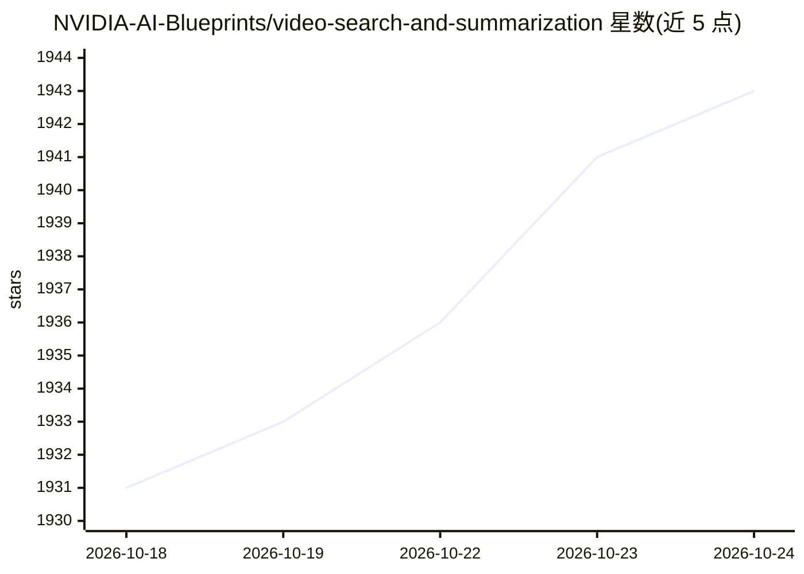

# NVIDIA-AI-Blueprints/video-search-and-summarization

⭐ 1,942 · Python · Apache-2.0 · 推送 2026-10-24 · [GitHub](https://github.com/NVIDIA-AI-Blueprints/video-search-and-summarization) · [官网](https://build.nvidia.com/nvidia/video-search-and-summarization) · 组织维护

**GPU 加速的视频分析与摘要 AI Agent 参考架构**

NVIDIA 发布的 VSS 蓝图，提供一整套用于构建视频 AI agent 的参考架构与微服务：实时视频智能（特征提取、嵌入、2D/3D 检测跟踪）、下游分析（轨迹、事件、VLM 告警核验）、以及基于 MCP 的 agent 工具层，支持自然语言视频检索、视觉问答、长视频摘要与片段提取。模型侧使用 NIM 微服务（Cosmos3 Nano Reasoner、Nemotron 3.5 Lightning）。面向视频分析师与 GenAI/ML 工程师，需 NVIDIA AI Enterprise 许可证本地托管 NIM，依赖 GPU，通过 Docker Compose/Helm 部署。

## 筛选速览

| 维度 | 判定 | 备注 |
|---|---|---|
| AI 角色 | `ai-ecosystem` | LLM/agent 周边工具 |
| 许可风险 | `permissive` | Apache-2.0 |
| 部署形态 | `self-host` | docker 或自建部署 |
| 模型依赖 | — | README 未给出锁定关系 |
| 硬件要求 | — | 无带数字的原话,不猜 |
| 安装摩擦 | `low` | 无编译、无系统依赖或容器化 |
| 成熟度 | — | 结构信号不足 |

## 能力要点

- 三层架构：实时视频智能、下游分析、基于 MCP 的 agent 工具编排
- VLM 告警核验以降低误报，长视频分块摘要生成时间戳字幕与事件
- NIM 微服务承载 Cosmos3 Nano Reasoner 与 Nemotron 3.5 Lightning 模型
- 兼容 RTSP/ONVIF/Milestone 摄像头与 VMS 系统接入

## 适用场景

- 对园区、仓库等监控视频做自然语言检索与告警核验
- 构建视觉问答与自动报告生成的视频分析 agent
- 对数小时录像做长视频摘要与片段提取

## 场景标签

`RAG` `图像视频处理` · 领域:知识与检索

## 证据(README 行号)

> L18: The NVIDIA Blueprint for Video Search and Summarization (VSS) provides a suite of reference architectures for build
> L22: This repository implements the blueprint and powers the NVIDIA build experience for natural-language video agents—s
> L26: The NVIDIA AI Blueprint for Video Search and Summarization addresses the challenge of deploying visual agents capab

## 星数曲线

2026-10-18 1,931 → 2026-10-24 1,943（+12）

---
*卡片 v1 · prompt 1.4 · 生成 2026-10-21 · 置信度 high · 依据 README sha `98f06737bce4` · [字段定义](../../DATASET.md)*
