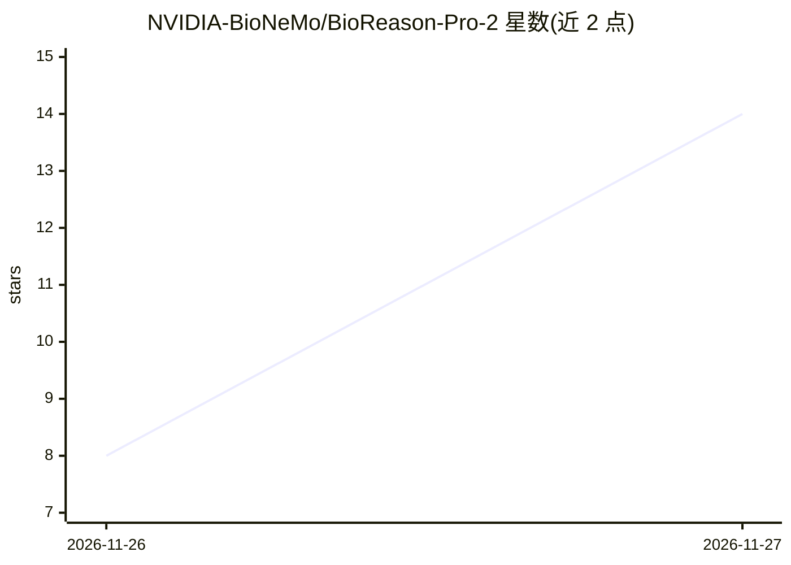

# NVIDIA-BioNeMo/BioReason-Pro-2

⭐ 14 · Python · MIT · 推送 2026-11-24 · [GitHub](https://github.com/NVIDIA-BioNeMo/BioReason-Pro-2) · [官网](https://www.goodfire.com/research/building-stronger-biological-reasoning-models) · 组织维护

**给科研人员做蛋白质功能预测的多模态推理 LLM**

仓库提供 BioReason-Pro 2 的推理、评分与训练代码（SFT 后接 GRPO 强化学习）：将蛋白质的 ESM3 嵌入与生物学上下文（物种、GO-GPT 的 GO 项预测、已知互作伙伴、可选 InterPro 特征）输入同一语言模型，输出蛋白质功能与 GO 项。附 GO-GPT 预测器、CAFA 基准评测、LLM judge 与 grounding 评分流程。代码 MIT 许可，模型权重为 OpenMDW-1.1；SFT 所用 Kimi K3 推理轨迹未发布，故监督微调不可由公开数据复现。

## 筛选速览

| 维度 | 判定 | 备注 |
|---|---|---|
| AI 角色 | `ai-native` | 本体是模型或模型工具 |
| 许可风险 | `permissive` | MIT |
| 部署形态 | `library` | 以包/库形式分发 |
| 模型依赖 | local-ok | 支持本地模型 |
| 硬件要求 | — | 无带数字的原话,不猜 |
| 安装摩擦 | `medium` | 含编译或系统依赖之一 |
| 成熟度 | — | 结构信号不足 |

## 能力要点

- 多模态输入：ESM3 嵌入、GO 图编码器、互作伙伴与可选 InterPro 特征
- 提供 RL（GRPO+LLM judge 奖励）与 SFT 两个 9B 模型权重（HuggingFace）
- 内置评测套件：Fmax、IA 加权指标、LLM judge、残基/InterPro/跨度 grounding 校验
- GO-GPT 与 InterPro 结果缓存，支持 --resume 断点续跑

## 适用场景

- 对新蛋白质序列预测 GO 功能注释
- 在 CAFA 基准或自有标注数据上评测模型
- 训练/复现强化学习版本的蛋白质功能推理模型

## 场景标签

`科研工具` `多模态` `强化学习` `模型评测` · 领域:评测与运维

## 证据(README 行号)

> L14: Multimodal protein function prediction. A protein's ESM3 embedding and its biological context
> L19: This repository holds the code that predicts with the models, scores them and trains them (supervised
> L40: python predict.py --input data/examples/proteins.tsv --output runs/example/predictions.tsv

## 星数曲线

2026-11-26 8 → 2026-11-27 14（+6）

---
*卡片 v1 · prompt 1.4 · 生成 2026-11-26 · 置信度 high · 依据 README sha `3486c150ca39` · [字段定义](../../DATASET.md)*
