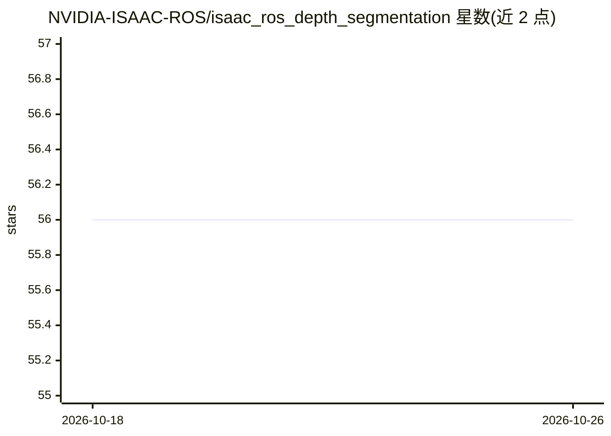

# NVIDIA-ISAAC-ROS/isaac_ros_depth_segmentation

⭐ 56 · C++ · Apache-2.0 · 推送 2025-12-11 · [GitHub](https://github.com/NVIDIA-ISAAC-ROS/isaac_ros_depth_segmentation) · 组织维护

**机器人开发者用 Bi3D 做立体深度分割与避障**

NVIDIA Isaac ROS 系列中的深度分割包：isaac_ros_bi3d 使用 Bi3D DNN 模型，通过对时间同步的左右立体图像对进行二分类推断障碍物是否处于临近场，并同时预测地面自由空间，用于导航避障。推理经 TensorRT 执行，可在 NVIDIA DLA 上运行、独立于 GPU；输入图像需矫正并缩放至合适分辨率且保持宽高比。面向 ROS 2（Humble）机器人开发者，提供 AGX Orin、Orin NX 与 x86_64+RTX 4090 的性能数据，兼容 JetPack 6.1。注意其对 RGB 全局快门相机图像优化，单色图像精度可能变化。

## 筛选速览

| 维度 | 判定 | 备注 |
|---|---|---|
| AI 角色 | `ai-native` | 本体是模型或模型工具 |
| 许可风险 | `permissive` | Apache-2.0 |
| 部署形态 | `None` |  |
| 模型依赖 | — | README 未给出锁定关系 |
| 硬件要求 | — | 无带数字的原话,不猜 |
| 安装摩擦 | `low` | 无编译、无系统依赖或容器化 |
| 成熟度 | — | 结构信号不足 |

## 能力要点

- Bi3D DNN 通过二分类做立体深度分割与自由空间预测
- 推理使用 TensorRT，可在 DLA 上运行、独立于 GPU
- 基于 NITROS 的消息传输加速
- 提供 AGX Orin / Orin NX / RTX 4090 上的 fps 与延迟数据

## 适用场景

- 移动机器人导航中判断障碍物是否进入临近场以避免碰撞
- 结合地面自由空间预测做可通行区域判定
- 在 Jetson 平台上部署加速的立体感知节点

## 场景标签

`目标检测` · 领域:感知与多模态

## 证据(README 行号)

> L13: Isaac ROS Depth Segmentation provides NVIDIA NVIDIA-accelerated packages for
> L17: to perform stereo-depth estimation via binary classification, which is

## 星数曲线

2026-10-18 56 → 2026-10-26 56（+0）

---
*卡片 v1 · prompt 1.4 · 生成 2026-10-24 · 置信度 high · 依据 README sha `e80d4a4f4159` · [字段定义](../../DATASET.md)*
