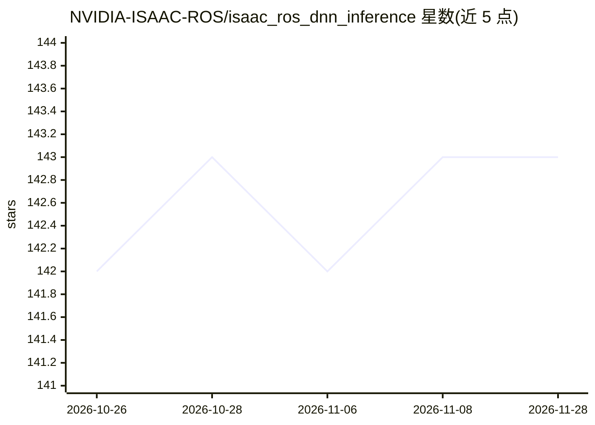

# NVIDIA-ISAAC-ROS/isaac_ros_dnn_inference

⭐ 143 · C++ · Apache-2.0 · 推送 2026-11-18 · [GitHub](https://github.com/NVIDIA-ISAAC-ROS/isaac_ros_dnn_inference) · [官网](https://developer.nvidia.com/isaac-ros-gems) · 组织维护

**为机器人提供 NVIDIA 加速 DNN 推理的 ROS 2 软件包**

包含 TensorRT 与 Triton 两个 ROS 2 推理节点：输入图像经 DNN encoder 转为 Tensor，推理后由 DNN decoder 转回边界框/分割结果，供机器人感知应用使用。TensorRT 针对目标硬件优化模型，不支持的新模型可走 Triton 节点，后者支持 ONNX Runtime、TensorFlow、PyTorch 等多种后端。运行于 Jetson 与带 CUDA GPU 的 x86_64；使用 ROS 2 Lyrical 的 rosidl::Buffer 减少 CPU 与加速器内存间拷贝。安装与使用说明位于 Isaac ROS Documentation。

## 筛选速览

| 维度 | 判定 | 备注 |
|---|---|---|
| AI 角色 | `ai-ecosystem` | LLM/agent 周边工具 |
| 许可风险 | `permissive` | Apache-2.0 |
| 部署形态 | `None` |  |
| 模型依赖 | — | README 未给出锁定关系 |
| 硬件要求 | — | 无带数字的原话,不猜 |
| 安装摩擦 | `medium` | 含编译或系统依赖之一 |
| 成熟度 | — | 结构信号不足 |

## 能力要点

- TensorRT 与 Triton 两个 ROS 2 推理节点
- Triton 支持 ONNX Runtime/TensorRT/TensorFlow/PyTorch 等后端
- 提供图像边界框检测与分割的 encoder/decoder 节点
- 基于 rosidl::Buffer 的 CUDA 内存存储与传输

## 适用场景

- 在 Jetson 或 x86_64 GPU 上运行机器人视觉感知模型
- 通过 ROS 2 图集成 DOPE、PeopleSemSegNet 等预训练 DNN
- 为自定义 DNN 模型搭建推理流水线

## 场景标签

`推理引擎` `目标检测` · 领域:感知与多模态

## 证据(README 行号)

> L15: Isaac ROS DNN Inference contains ROS 2 packages for performing DNN
> L32: TensorRT and Triton are two separate ROS nodes to perform DNN inference.

## 星数曲线

2026-10-26 142 → 2026-11-28 143（+1）

---
*卡片 v1 · prompt 1.4 · 生成 2026-11-27 · 置信度 mid · 依据 README sha `793d27289452` · [字段定义](../../DATASET.md)*
