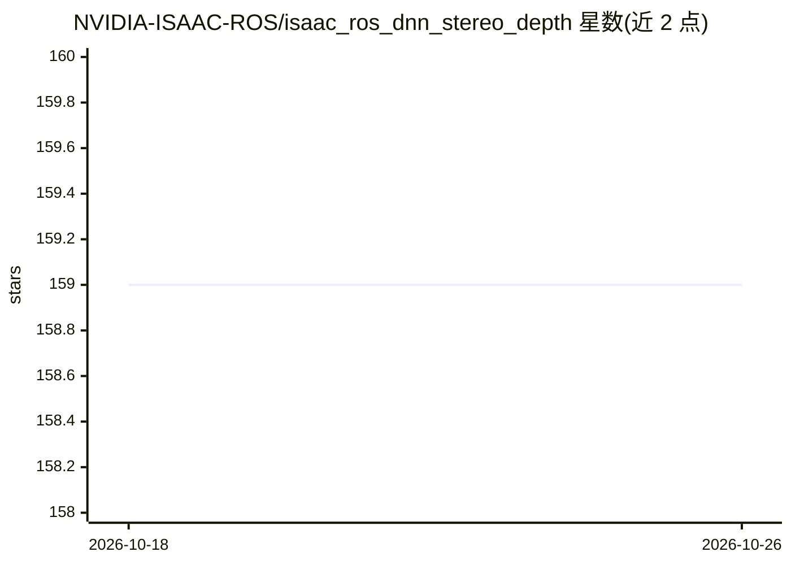

# NVIDIA-ISAAC-ROS/isaac_ros_dnn_stereo_depth

⭐ 159 · C++ · Apache-2.0 · 推送 2026-09-22 · [GitHub](https://github.com/NVIDIA-ISAAC-ROS/isaac_ros_dnn_stereo_depth) · [官网](https://developer.nvidia.com/isaac-ros-gems) · 组织维护

**NVIDIA 加速的深度学习双目视差估计 ROS 2 包**

Isaac ROS 系列中的 DNN 双目深度估计包，通过 ESS 与 FoundationStereo 等 DNN 模型从左右相机图像生成稠密视差/深度图，面向机器人与自主系统的避障、机械臂操作和目标跟踪场景。利用 ROS 2 原生 rosidl::Buffer 与 CUDA buffer 后端在 CPU 与加速器间传输数据，减少大载荷拷贝。提供三个子包（decoder/ESS/FoundationStereo），README 附 AGX Thor、Orin、RTX GPU 等硬件上的性能表，具体安装与使用指向 Isaac ROS 文档站。

## 筛选速览

| 维度 | 判定 | 备注 |
|---|---|---|
| AI 角色 | `ai-native` | 本体是模型或模型工具 |
| 许可风险 | `permissive` | Apache-2.0 |
| 部署形态 | `None` |  |
| 模型依赖 | — | README 未给出锁定关系 |
| 硬件要求 | — | 无带数字的原话,不猜 |
| 安装摩擦 | `medium` | 含编译或系统依赖之一 |
| 成熟度 | — | 结构信号不足 |

## 能力要点

- ESS 与 FoundationStereo 两种 DNN 立体视差模型
- 基于 ROS 2 rosidl::Buffer 与 CUDA buffer 后端的数据传输
- 提供 isaac_ros_dnn_stereo_decoder 等三个子包
- 附多平台（Jetson/RTX GPU）性能基准表

## 适用场景

- 为机器人生成稠密深度图用于避障与导航
- 机械臂精确操作中的深度感知
- 动态杂乱环境下的目标跟踪

## 场景标签

`图像视频处理` · 领域:感知与多模态

## 证据(README 行号)

> L3: NVIDIA-accelerated, deep learned stereo disparity estimation
> L14: Deep Neural Network (DNN)–based stereo models have become essential for depth estimation because they
> L102: * `isaac_ros_foundationstereo`

## 星数曲线

2026-10-18 159 → 2026-10-26 159（+0）

---
*卡片 v1 · prompt 1.4 · 生成 2026-10-22 · 置信度 high · 依据 README sha `a09780f4d217` · [字段定义](../../DATASET.md)*
