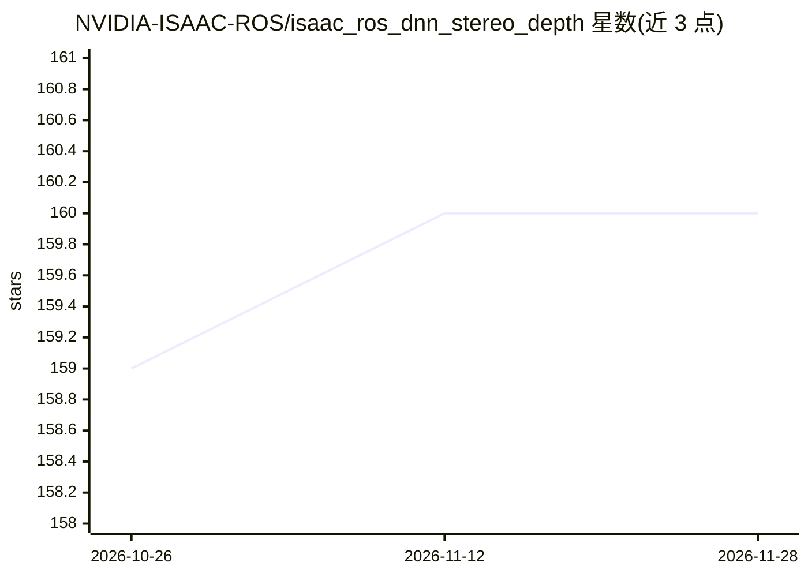

# NVIDIA-ISAAC-ROS/isaac_ros_dnn_stereo_depth

⭐ 160 · C++ · Apache-2.0 · 推送 2026-11-18 · [GitHub](https://github.com/NVIDIA-ISAAC-ROS/isaac_ros_dnn_stereo_depth) · [官网](https://developer.nvidia.com/isaac-ros-gems) · 组织维护

**面向机器人的 NVIDIA GPU 加速 DNN 立体视差深度估计 ROS 2 包**

NVIDIA Isaac ROS 下的立体视觉深度估计包集合，包含 ESS 与 FoundationStereo 等 DNN 立体模型实现，从左右目图像生成稠密视差/深度图，用于机械臂操作、避障导航与目标跟踪等机器人感知场景。利用 CUDA 加速，基于 ROS 2 Lyrical 的 rosidl::Buffer 特性减少 CPU 与加速器间的数据拷贝。性能表覆盖 Jetson（AGX Thor/Orin、Orin Nano）与 x86 + RTX GPU 平台；安装与使用说明位于 Isaac ROS 文档站而非本 README。

## 筛选速览

| 维度 | 判定 | 备注 |
|---|---|---|
| AI 角色 | `ai-native` | 本体是模型或模型工具 |
| 许可风险 | `permissive` | Apache-2.0 |
| 部署形态 | `None` |  |
| 模型依赖 | — | README 未给出锁定关系 |
| 硬件要求 | — | 无带数字的原话,不猜 |
| 安装摩擦 | `medium` | 含编译或系统依赖之一 |
| 成熟度 | — | 结构信号不足 |

## 能力要点

- 提供 isaac_ros_ess 与 isaac_ros_foundationstereo 等 DNN 立体视差估计包
- 基于 ROS 2 rosidl::Buffer 的 CUDA 缓冲后端减少 CPU-GPU 数据拷贝
- 性能表给出 Jetson 与 x86/RTX 多平台的帧率与延迟数据
- 兼容 Isaac ROS 5.1.0 发布

## 适用场景

- 机械臂精密抓取的深度感知
- 移动机器人避障与导航
- 动态或杂乱环境中的目标跟踪

## 场景标签

 · 领域:机器人/计算机视觉

## 证据(README 行号)

> L3: NVIDIA-accelerated, deep learned stereo disparity estimation
> L14: Deep Neural Network (DNN)–based stereo models have become essential for depth estimation because they
> L82: |Sample Graph|Input Size|AGX Thor T5000|AGX Thor T4000|AGX Orin|Orin Nano Super 8GB|DGX Spark|x86_64 w/ RTX 5090|x8

## 星数曲线

2026-10-26 159 → 2026-11-28 160（+1）

---
*卡片 v1 · prompt 1.4 · 生成 2026-11-27 · 置信度 high · 依据 README sha `296f5fd9fd46` · [字段定义](../../DATASET.md)*
