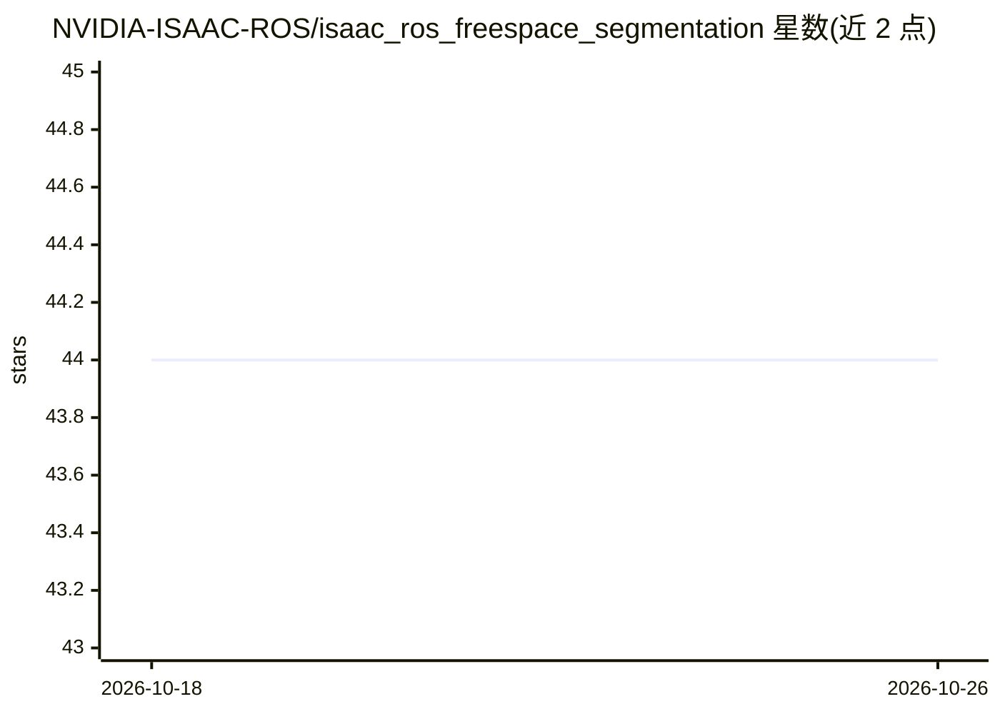

# NVIDIA-ISAAC-ROS/isaac_ros_freespace_segmentation

⭐ 44 · C++ · Apache-2.0 · 推送 2025-12-11 · [GitHub](https://github.com/NVIDIA-ISAAC-ROS/isaac_ros_freespace_segmentation) · [官网](https://developer.nvidia.com/isaac-ros-gems) · 组织维护

**ROS 2 包：用 Bi3D 深度学习生成立体视觉自由空间占据栅格**

Isaac ROS Freespace Segmentation 提供 ROS 2 包 isaac_ros_bi3d_freespace，基于 Bi3D 对时间同步的左右立体图像对生成分割掩码，再结合相机相对地面的 TF 位姿计算平面自由空间，输出占据栅格供 Nav2 导航避障使用。GPU 加速（NITROS 优化节点间通信）以实现低延迟实时结果。README 给出在 AGX Orin、Orin NX、Orin Nano Super 8GB 及 x86_64 w/ RTX 4090 上的性能数据，2024-12 更新兼容 JetPack 6.1，面向移动地面机器人开发者。

## 筛选速览

| 维度 | 判定 | 备注 |
|---|---|---|
| AI 角色 | `ai-native` | 本体是模型或模型工具 |
| 许可风险 | `permissive` | Apache-2.0 |
| 部署形态 | `None` |  |
| 模型依赖 | — | README 未给出锁定关系 |
| 硬件要求 | — | 无带数字的原话,不猜 |
| 安装摩擦 | `low` | 无编译、无系统依赖或容器化 |
| 成熟度 | — | 结构信号不足 |

## 能力要点

- Bi3D 从立体图像对生成分割掩码并转为占据栅格
- 输出接入 Nav2 用于导航避障
- NITROS 加速节点间通信，GPU 实时低延迟
- 提供 AGX Orin / Orin NX / Orin Nano / RTX 4090 性能基准

## 适用场景

- 移动机器人导航中用视觉方式补充或替代 lidar 障碍物感知
- 检测低矮障碍物以扩展 lidar 视场覆盖
- 为 Nav2 提供额外的占据栅格来源

## 场景标签

`目标检测` · 领域:感知与多模态

## 证据(README 行号)

> L9: Isaac ROS Freespace Segmentation contains an ROS 2 package to produce
> L21: `isaac_ros_bi3d` is used in a graph of nodes to provide a freespace

## 星数曲线

2026-10-18 44 → 2026-10-26 44（+0）

---
*卡片 v1 · prompt 1.4 · 生成 2026-10-25 · 置信度 high · 依据 README sha `b6c4a20153e2` · [字段定义](../../DATASET.md)*
