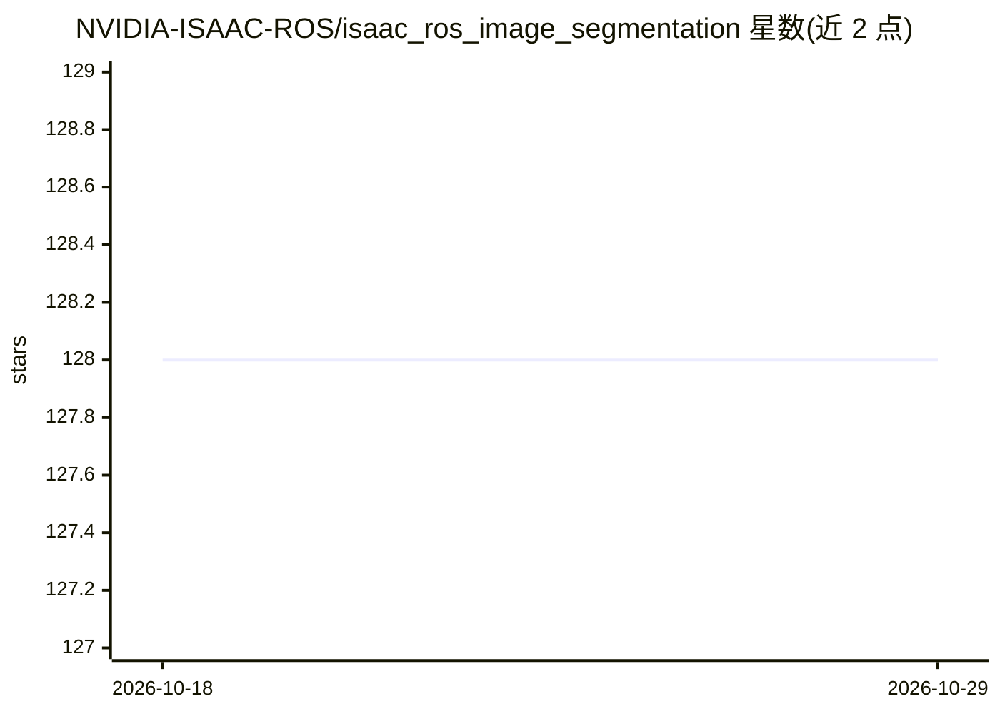

# NVIDIA-ISAAC-ROS/isaac_ros_image_segmentation

⭐ 128 · C++ · Apache-2.0 · 推送 2026-09-22 · [GitHub](https://github.com/NVIDIA-ISAAC-ROS/isaac_ros_image_segmentation) · 组织维护

**NVIDIA 加速的深度学习语义图像分割 ROS 2 软件包集**

Isaac ROS Image Segmentation 提供 ROS 2 语义图像分割软件包，在 GPU 上运行 DNN 推理，对输入图像逐像素分类。包含 4 种模型架构：U-NET（生物医学常用卷积网络）、Segformer（Transformer 架构）、Segment Anything 与 Segment Anything2（提示式分割与视频流跟踪）。通过 ROS 2 原生 rosidl::Buffer 与 CUDA buffer 后端避免 CPU 与加速器内存间的大负载拷贝。README 提供多种 Jetson 与 RTX 硬件上的推理性能数据，安装与用法需查阅 Isaac ROS 文档站点。

## 筛选速览

| 维度 | 判定 | 备注 |
|---|---|---|
| AI 角色 | `ai-native` | 本体是模型或模型工具 |
| 许可风险 | `permissive` | Apache-2.0 |
| 部署形态 | `None` |  |
| 模型依赖 | — | README 未给出锁定关系 |
| 硬件要求 | — | 无带数字的原话,不猜 |
| 安装摩擦 | `medium` | 含编译或系统依赖之一 |
| 成熟度 | — | 结构信号不足 |

## 能力要点

- 逐像素语义分割，输出可用于 2D 空间理解或与深度信息融合到 3D 场景
- 支持 U-NET、Segformer、Segment Anything、Segment Anything2 四种架构
- 基于 rosidl::Buffer 与 CUDA buffer 后端减少 CPU-GPU 内存拷贝
- 列出 AGX Thor/Orin、DGX Spark、RTX 5090/5070 等平台的 fps 性能数据

## 适用场景

- 机器人感知系统中对图像做逐像素类别识别
- 将分割结果与深度信息融合以定位 3D 场景中的物体
- 在 NVIDIA Jetson 边缘设备上运行实时分割推理

## 场景标签

`目标检测` · 领域:感知与多模态

## 证据(README 行号)

> L10: Isaac ROS Image Segmentation contains ROS packages for semantic image segmentation.
> L13: at the pixel level by running GPU-accelerated inference on a DNN model.

## 星数曲线

2026-10-18 128 → 2026-10-29 128（+0）

---
*卡片 v1 · prompt 1.4 · 生成 2026-10-22 · 置信度 high · 依据 README sha `3afea85ca293` · [字段定义](../../DATASET.md)*
