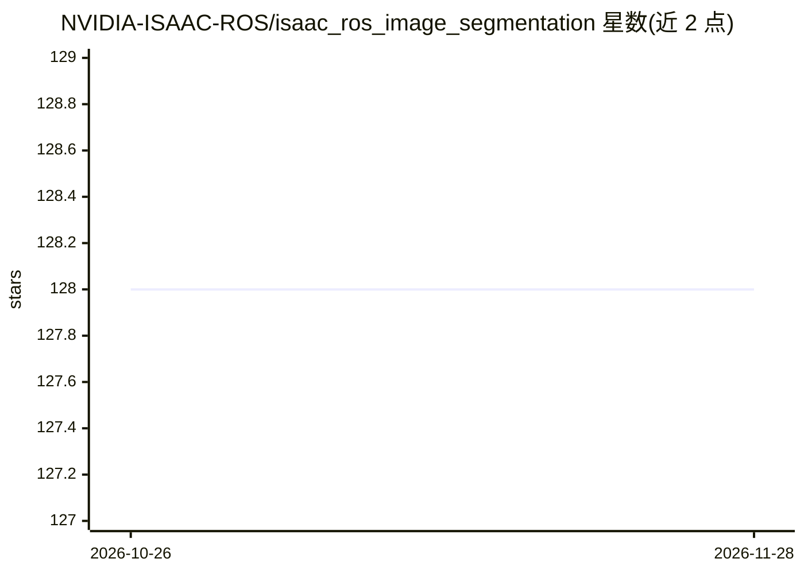

# NVIDIA-ISAAC-ROS/isaac_ros_image_segmentation

⭐ 128 · C++ · Apache-2.0 · 推送 2026-11-18 · [GitHub](https://github.com/NVIDIA-ISAAC-ROS/isaac_ros_image_segmentation) · 组织维护

**面向 ROS 2 开发者的 GPU 加速语义图像分割推理包**

NVIDIA Isaac ROS 提供的语义分割 ROS 2 软件包集合，包含 U-NET、Segformer、Segment Anything、Segment Anything2 四个包，通过在 DNN 模型上运行 GPU 加速推理对输入图像逐像素分类；分割结果可用于 2D 空间理解或与 3D 场景深度信息融合。利用 ROS 2 Lyrical 的 rosidl::Buffer 特性避免 CPU 与加速器间的大负载拷贝，使用 CUDA 缓冲区后端。性能表覆盖 AGX Thor、AGX Orin、DGX Spark 及 x86+RTX 等平台。安装与使用说明在 Isaac ROS Documentation 中提供。

## 筛选速览

| 维度 | 判定 | 备注 |
|---|---|---|
| AI 角色 | `ai-native` | 本体是模型或模型工具 |
| 许可风险 | `permissive` | Apache-2.0 |
| 部署形态 | `None` |  |
| 模型依赖 | — | README 未给出锁定关系 |
| 硬件要求 | — | 无带数字的原话,不猜 |
| 安装摩擦 | `medium` | 含编译或系统依赖之一 |
| 成熟度 | — | 结构信号不足 |

## 能力要点

- 提供 U-NET、Segformer、Segment Anything/2 四种分割模型架构的 ROS 2 包
- 使用 rosidl::Buffer 与 CUDA 缓冲区后端减少 CPU/加速器间数据拷贝
- 性能基准覆盖 Jetson、DGX Spark 与 x86 RTX 平台
- Segment Anything2 支持给定提示对视频流中的对象分割与跟踪

## 适用场景

- 机器人感知中逐像素分割输入图像
- 分割结果与深度信息融合定位 3D 场景中的物体
- 在 Jetson 平台上运行 GPU 加速的分割推理

## 场景标签

`目标检测` · 领域:感知与多模态

## 证据(README 行号)

> L10: Isaac ROS Image Segmentation contains ROS packages for semantic image segmentation.
> L13: at the pixel level by running GPU-accelerated inference on a DNN model.

## 星数曲线

2026-10-26 128 → 2026-11-28 128（+0）

---
*卡片 v1 · prompt 1.4 · 生成 2026-11-28 · 置信度 high · 依据 README sha `25df55579152` · [字段定义](../../DATASET.md)*
