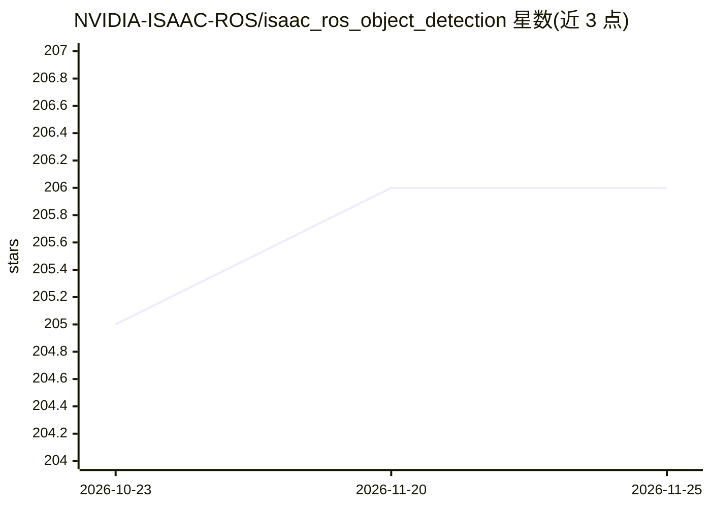

# NVIDIA-ISAAC-ROS/isaac_ros_object_detection

⭐ 206 · C++ · Apache-2.0 · 推送 2026-11-18 · [GitHub](https://github.com/NVIDIA-ISAAC-ROS/isaac_ros_object_detection) · [官网](https://developer.nvidia.com/isaac-ros-gems) · 组织维护

**基于 ROS 2 的 GPU 加速图像目标检测包集合**

NVIDIA Isaac ROS 的目标检测组件，包含 isaac_ros_rtdetr、isaac_ros_detectnet、isaac_ros_yolov8、isaac_ros_grounding_dino 四个 ROS 2 包，分别对应 RT-DETR、DetectNet、YOLOv8、Grounding DINO 模型架构。输入图像经 DNN 编码器预处理后由 GPU 加速模型推理，输出带类别标签的检测框数组。性能表覆盖 AGX Thor、AGX Orin、Orin Nano、DGX Spark 及 x86_64 + RTX GPU 平台。需要预训练模型才能产出检测阵列；使用需查阅 Isaac ROS 文档。

## 筛选速览

| 维度 | 判定 | 备注 |
|---|---|---|
| AI 角色 | `ai-native` | 本体是模型或模型工具 |
| 许可风险 | `permissive` | Apache-2.0 |
| 部署形态 | `None` |  |
| 模型依赖 | — | README 未给出锁定关系 |
| 硬件要求 | — | 无带数字的原话,不猜 |
| 安装摩擦 | `medium` | 含编译或系统依赖之一 |
| 成熟度 | — | 结构信号不足 |

## 能力要点

- 四个 ROS 2 包分别支持 RT-DETR/DetectNet/YOLOv8/Grounding DINO 架构
- GPU 加速推理，输出带类别的检测框数组
- 利用 ROS 2 rosidl::Buffer 与 CUDA buffer 后端减少 CPU-加速器间数据拷贝
- 给出多平台 fps/ms 性能数据表

## 适用场景

- 在 Jetson 或 NVIDIA GPU 平台上为机器人视觉管线添加目标检测节点
- 用 Grounding DINO 做开放词表的目标检测
- 在 ROS 2 图中对接下游感知函数处理检测数组

## 场景标签

`目标检测` · 领域:感知与多模态

## 证据(README 行号)

> L10: Isaac ROS Object Detection contains ROS 2 packages to perform object
> L14: is performed by a GPU-accelerated model of the appropriate architecture:

## 星数曲线

2026-10-23 205 → 2026-11-25 206（+1）

---
*卡片 v1 · prompt 1.4 · 生成 2026-11-25 · 置信度 high · 依据 README sha `80319c86a35e` · [字段定义](../../DATASET.md)*
