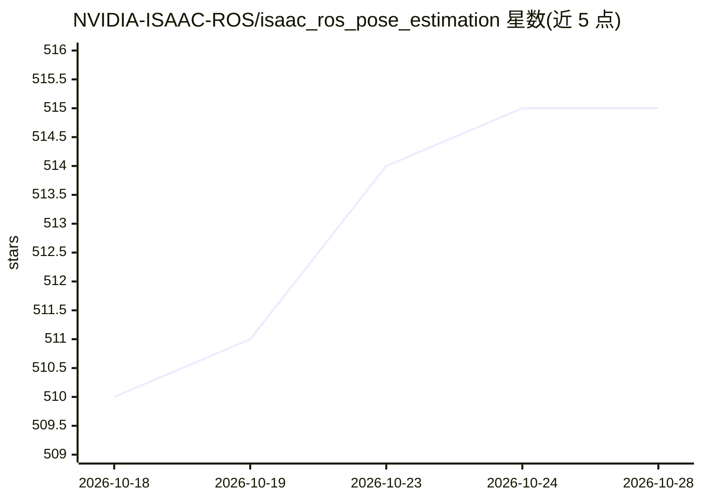

# NVIDIA-ISAAC-ROS/isaac_ros_pose_estimation

⭐ 515 · C++ · Apache-2.0 · 推送 2026-09-22 · [GitHub](https://github.com/NVIDIA-ISAAC-ROS/isaac_ros_pose_estimation) · [官网](https://developer.nvidia.com/isaac-ros-gems) · 组织维护

**ROS 2 三包 3D 物体位姿估计，GPU 加速推理**

Isaac ROS Pose Estimation 提供 isaac_ros_foundationpose、isaac_ros_dope、isaac_ros_centerpose 三个 ROS 2 包，用 GPU 加速 DNN 推理估计物体 6-DoF 位姿，输出可与深度数据融合用于导航或机械臂操作。foundationpose 基于 FoundationPose 模型，无需微调即可处理未见物体并支持跟踪；dope 需针对特定物体预训练模型；centerpose 可按类别检测。推理依赖 Isaac ROS DNN Inference 的 Triton/TensorRT 加速与 DNN Image Encoder 预处理。

## 筛选速览

| 维度 | 判定 | 备注 |
|---|---|---|
| AI 角色 | `ai-native` | 本体是模型或模型工具 |
| 许可风险 | `permissive` | Apache-2.0 |
| 部署形态 | `None` |  |
| 模型依赖 | — | README 未给出锁定关系 |
| 硬件要求 | — | 无带数字的原话,不猜 |
| 安装摩擦 | `low` | 无编译、无系统依赖或容器化 |
| 成熟度 | — | 结构信号不足 |

## 能力要点

- 三个包分别支持未见物体位姿估计（FoundationPose）、已知物体（DOPE）、类别级（CenterPose）
- FoundationPose 跟踪模式在 Jetson Thor 平台超过 120 FPS
- 推理依赖 Triton/TensorRT GPU 加速与 Isaac ROS DNN Image Encoder 预处理
- README 列出 AGX Thor/Orin/DGX Spark/RTX 等多平台性能数据

## 适用场景

- 移动机器人导航中估计目标物体 3D 位姿与距离
- 机械臂抓取前的物体位姿识别
- 对未见新物体免训练直接做位姿估计与跟踪

## 场景标签

 · 领域:机器人/计算机视觉

## 证据(README 行号)

> L3: Deep learned, NVIDIA-accelerated 3D object pose estimation
> L18: Those packages use GPU acceleration for DNN inference to

## 星数曲线

2026-10-18 510 → 2026-10-28 515（+5）

---
*卡片 v1 · prompt 1.4 · 生成 2026-10-21 · 置信度 high · 依据 README sha `376266b859d7` · [字段定义](../../DATASET.md)*
