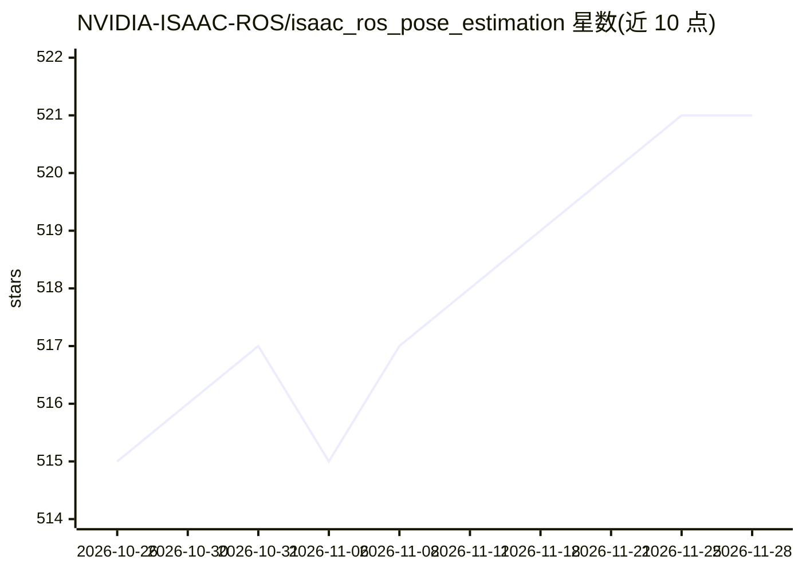

# NVIDIA-ISAAC-ROS/isaac_ros_pose_estimation

⭐ 521 · C++ · Apache-2.0 · 推送 2026-11-18 · [GitHub](https://github.com/NVIDIA-ISAAC-ROS/isaac_ros_pose_estimation) · [官网](https://developer.nvidia.com/isaac-ros-gems) · 组织维护

**为机器人开发者提供 GPU 加速的 3D 物体位姿估计 ROS 2 包**

包含三个 ROS 2 包（isaac_ros_foundationpose、isaac_ros_dope、isaac_ros_centerpose），用 GPU 加速的 DNN 推理预测物体位姿，输出可融合深度信息用于导航或操作。三个包在是否需重训、TAO 支持、速度与成熟度上各有差异：FoundationPose 无需微调即可处理未见物体并支持跟踪；DOPE 需预训练模型；CenterPose 对已知类别做检测与 6-DoF 估计。推理依赖 Isaac ROS DNN Inference 的 Triton 或 TensorRT，性能表覆盖 Jetson/AGX Orin/x86+RTX 等平台。

## 筛选速览

| 维度 | 判定 | 备注 |
|---|---|---|
| AI 角色 | `ai-native` | 本体是模型或模型工具 |
| 许可风险 | `permissive` | Apache-2.0 |
| 部署形态 | `None` |  |
| 模型依赖 | — | README 未给出锁定关系 |
| 硬件要求 | — | 无带数字的原话,不猜 |
| 安装摩擦 | `low` | 无编译、无系统依赖或容器化 |
| 成熟度 | — | 结构信号不足 |

## 能力要点

- 三个 ROS 2 位姿估计节点：FoundationPose、DOPE、CenterPose
- FoundationPose 无需微调即可估计未见物体位姿并支持跟踪
- 依赖 Triton/TensorRT 进行 GPU 加速 DNN 推理
- 给出 Jetson/Orin/x86 多平台性能数据表

## 适用场景

- 机器人抓取与操作前估计物体 3D 位姿
- 为导航系统提供物体位置与距离感知
- 在 Jetson 平台部署实时位姿估计
- 参照教程训练自定义物体的 DOPE 模型

## 场景标签

`目标检测` · 领域:感知与多模态

## 证据(README 行号)

> L10: three ROS 2 packages to predict the pose of an object. Refer the following table to see the differences of them:
> L18: Those packages use GPU acceleration for DNN inference to
> L76: Packages in this repository rely on accelerated DNN model inference

## 星数曲线

2026-10-26 515 → 2026-11-28 521（+6）

---
*卡片 v1 · prompt 1.4 · 生成 2026-11-25 · 置信度 high · 依据 README sha `5885c4588906` · [字段定义](../../DATASET.md)*
