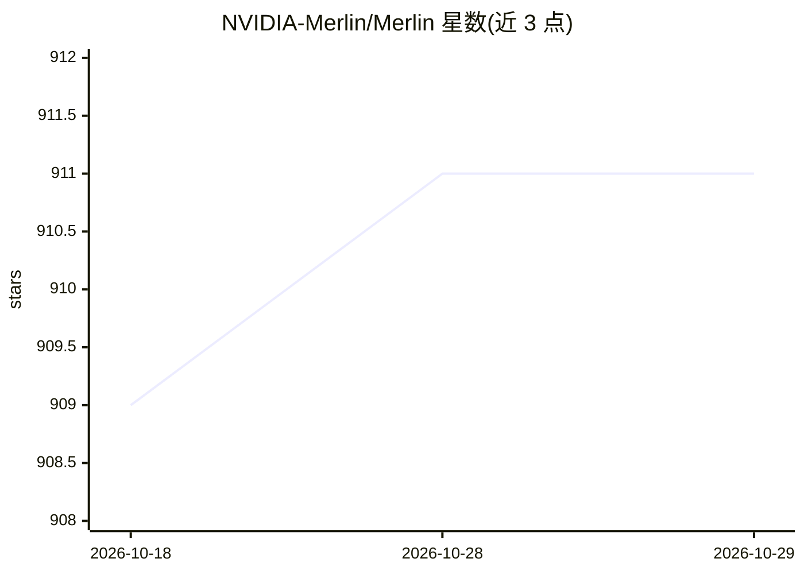

# NVIDIA-Merlin/Merlin

⭐ 911 · Python · Apache-2.0 · 推送 2026-07-22 · [GitHub](https://github.com/NVIDIA-Merlin/Merlin) · 组织维护

**GPU 加速的端到端推荐系统开源库，覆盖 ETL/训练/部署**

NVIDIA 维护的推荐系统加速库集合，面向数据科学家、机器学习工程师与研究人员。包含 NVTabular（特征工程与预处理）、HugeCTR（多 GPU/多节点分布式训练）、Merlin Models（标准推荐模型）、Transformers4Rec（序列/会话推荐）、Merlin Systems（基于 Triton 的生产部署）与 Merlin Core 等组件。各阶段管线支持数百 TB 规模数据，可分发超出 GPU/CPU 内存的大型嵌入表。推荐通过 NGC Docker 容器使用，开发环境可用 conda 或 pip 搭建，依赖 RAPIDS cuDF、Dask 与 Triton Inference Server。

## 筛选速览

| 维度 | 判定 | 备注 |
|---|---|---|
| AI 角色 | `ai-ecosystem` | LLM/agent 周边工具 |
| 许可风险 | `permissive` | Apache-2.0 |
| 部署形态 | `library` | 以包/库形式分发 |
| 模型依赖 | — | README 未给出锁定关系 |
| 硬件要求 | — | 无带数字的原话,不猜 |
| 安装摩擦 | `low` | 无编译、无系统依赖或容器化 |
| 成熟度 | — | 结构信号不足 |

## 能力要点

- ETL、训练、推理全流程组件，API 覆盖数百 TB 数据规模
- HugeCTR 支持多 GPU/多节点分布式训练与按需加载大型嵌入表
- 支持 TensorFlow/PyTorch/FastAI 训练管线加速
- 通过 Triton Inference Server 提供生产级推荐管线部署

## 适用场景

- 在大规模表格数据上做推荐系统特征工程与预处理
- 训练超出单机内存的大型深度学习推荐模型
- 将训练好的推荐模型经 Triton 部署为端到端生产管线

## 场景标签

`推荐系统` · 领域:学习与行业

## 证据(README 行号)

> L7: NVIDIA Merlin is an open source library that accelerates recommender systems on
> L51: HugeCTR is a GPU-accelerated training framework that can scale large deep learning
> L96: - Start with an integrated platform for serving recommendations built on Triton

## 星数曲线

2026-10-18 909 → 2026-10-29 911（+2）

---
*卡片 v1 · prompt 1.4 · 生成 2026-10-21 · 置信度 mid · 依据 README sha `a3c6aebc5cb6` · [字段定义](../../DATASET.md)*
