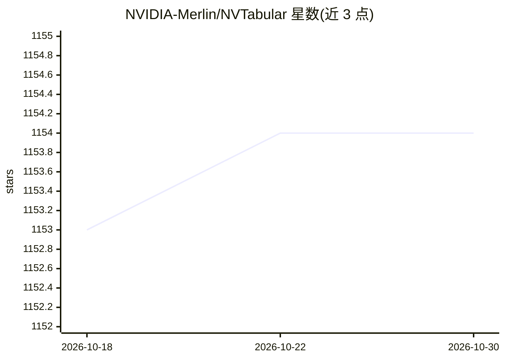

# NVIDIA-Merlin/NVTabular

⭐ 1,154 · Python · Apache-2.0 · 推送 2026-05-22 · [GitHub](https://github.com/NVIDIA-Merlin/NVTabular) · 组织维护

**面向推荐系统的表格数据 GPU 特征工程与预处理库**

NVIDIA Merlin 框架的组件之一，为深度学习推荐系统提供 TB 级表格数据的特征工程与预处理：基于 RAPIDS Dask-cuDF 在 GPU 上加速计算，可在超出 GPU/CPU 内存的数据集上工作，通过操作级抽象简化代码。训练阶段的预处理可经 Triton Inference Server 自动应用到推理时的新数据。面向数据科学家与 ML 工程师。需 Python 3.7+，GPU 支持需 CUDA 11.0+、Compute Capability 6.0 以上的 NVIDIA GPU 与指定驱动，运行于 Linux/WSL；pip 安装仅 CPU 模式。提供 conda/pip 安装与三个 Merlin Docker 容器。

## 筛选速览

| 维度 | 判定 | 备注 |
|---|---|---|
| AI 角色 | `ai-ecosystem` | LLM/agent 周边工具 |
| 许可风险 | `permissive` | Apache-2.0 |
| 部署形态 | `library` | 以包/库形式分发 |
| 模型依赖 | — | README 未给出锁定关系 |
| 硬件要求 | `cpu-ok` | |
| 安装摩擦 | `medium` | 含编译或系统依赖之一 |
| 成熟度 | — | 结构信号不足 |

## 能力要点

- 基于 RAPIDS Dask-cuDF 的 GPU 加速特征工程与预处理
- 处理超出 GPU/CPU 内存的 TB 级数据集
- 预处理流程经 Triton Inference Server 复用于推理阶段
- 提供 conda/pip 安装及三种 Merlin Docker 容器

## 适用场景

- 为深度学习推荐系统准备大规模训练数据
- 在 GPU 上加速 ETL 与特征工程迭代
- 将训练时的预处理步骤一致地应用于线上推理数据

## 场景标签

`推荐系统` · 领域:学习与行业

## 证据(README 行号)

> L7: NVTabular is a feature engineering and preprocessing library for tabular data that is designed to easily manipulate 
> L9: NVTabular is a component of NVIDIA Merlin, an open source framework for building and deploying recommender systems a

## 星数曲线

2026-10-18 1,153 → 2026-10-30 1,154（+1）

---
*卡片 v1 · prompt 1.4 · 生成 2026-10-21 · 置信度 high · 依据 README sha `549c948d9808` · [字段定义](../../DATASET.md)*
