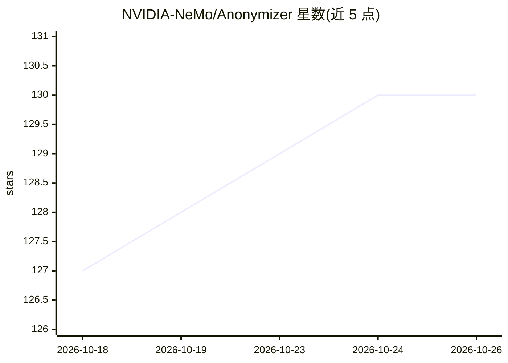

# NVIDIA-NeMo/Anonymizer

⭐ 130 · Python · Apache-2.0 · 推送 2026-10-25 · [GitHub](https://github.com/NVIDIA-NeMo/Anonymizer) · [官网](https://nvidia-nemo.github.io/Anonymizer/latest/) · 组织维护

**面向开发者的文本 PII 检测与匿名化库（GLiNER+LLM）**

NVIDIA 维护的 Python 库，用 GLiNER-PII 检测文本中的敏感实体，经 LLM 增强与校验后按四种策略替换：LLM 生成替身、遮盖、注记或本地确定性哈希。默认检测走本地 GLiNER2 端点，文本 LLM 默认经 OpenRouter 托管，也可用自定义 provider YAML 换任意端点。提供 CLI、Python SDK 与 Agent Skill（npx 安装），支持 preview 小样本预览。测试主要覆盖英语，多语言质量未系统评估；收集匿名运行级遥测，可随时退出。

## 筛选速览

| 维度 | 判定 | 备注 |
|---|---|---|
| AI 角色 | `ai-native` | 本体是模型或模型工具 |
| 许可风险 | `permissive` | Apache-2.0 |
| 部署形态 | `library` | 以包/库形式分发 |
| 模型依赖 | locked-api |  |
| 硬件要求 | — | 无带数字的原话,不猜 |
| 安装摩擦 | `medium` | 含编译或系统依赖之一 |
| 成熟度 | — | 结构信号不足 |

## 能力要点

- GLiNER-PII + LLM 增强校验的实体检测
- 4 种替换策略：Substitute/Redact/Annotate/Hash（哈希为本地确定性）
- CLI 与 Python API，preview() 小样本预览
- 附带 Agent Skill，npx skills add 安装

## 适用场景

- 在训练数据合成或共享前匿名化 PII
- 按合规要求对数据集中的姓名、电话、证件号做检测替换
- 先用小样本预览验证检测与替换效果再全量运行

## 场景标签

 · 领域:数据隐私/文本处理

## 证据(README 行号)

> L6: **Detect and replace sensitive entities in text using LLM-powered workflows.**
> L10: - **Detect entities** using GLiNER-PII and LLM-based augmentation and validation
> L11: - **Replace with 4 strategies** — LLM-generated substitute, redact, annotate, or hash (deterministic, local)

## 星数曲线

2026-10-18 127 → 2026-10-26 130（+3）

---
*卡片 v1 · prompt 1.4 · 生成 2026-10-23 · 置信度 mid · 依据 README sha `3e70eb1701c5` · [字段定义](../../DATASET.md)*
