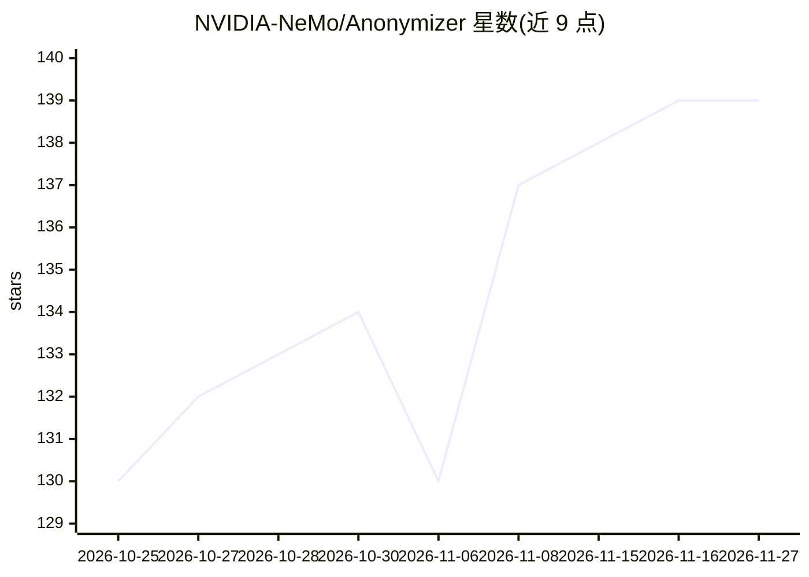

# NVIDIA-NeMo/Anonymizer

⭐ 139 · Python · Apache-2.0 · 推送 2026-11-25 · [GitHub](https://github.com/NVIDIA-NeMo/Anonymizer) · [官网](https://nvidia-nemo.github.io/Anonymizer/latest/) · 组织维护

**文本 PII 匿名化工具库：检测并用 LLM 改写敏感信息**

NeMo Framework 下的 Python 库与 CLI，用 GLiNER-PII 本地端点检测实体，配合 OpenRouter 托管的文本 LLM 做增强与校验，并提供 4 种替换策略：LLM 生成替身、删除、标注、确定性本地哈希。支持预览、typed records 内存输入、自定义 provider YAML；README 说明多语言质量尚未系统评估，主要在英文数据上测试。依赖 Python 3.11 与 NeMo Data Designer，Apache 2.0 许可，匿名运行级遥测可关闭。

## 筛选速览

| 维度 | 判定 | 备注 |
|---|---|---|
| AI 角色 | `ai-native` | 本体是模型或模型工具 |
| 许可风险 | `permissive` | Apache-2.0 |
| 部署形态 | `library` | 以包/库形式分发 |
| 模型依赖 | local-ok | 支持本地模型 |
| 硬件要求 | — | 无带数字的原话,不猜 |
| 安装摩擦 | `low` | 无编译、无系统依赖或容器化 |
| 成熟度 | — | 结构信号不足 |

## 能力要点

- GLiNER-PII 本地检测 + LLM 增强校验的两段式流水线
- 4 种替换策略：LLM 替身、redact、annotate、确定性哈希
- CLI、Python API 与内存 typed records 输入
- 附带 Agent Skill（npx skills add 安装）辅助起草脚本

## 适用场景

- 在把文本数据交给下游模型训练前清除个人敏感信息
- 服务内存中文本记录的批量脱敏处理
- 对非美区格式的电话/地址/证件号做匿名化实验

## 场景标签

 · 领域:数据隐私/文本匿名化

## 证据(README 行号)

> L6: **Detect and replace sensitive entities in text using LLM-powered workflows.**
> L10: - **Detect entities** using GLiNER-PII and LLM-based augmentation and validation
> L11: - **Replace with 4 strategies** — LLM-generated substitute, redact, annotate, or hash (deterministic, local)

## 星数曲线

2026-10-25 130 → 2026-11-27 139（+9）

---
*卡片 v1 · prompt 1.4 · 生成 2026-11-27 · 置信度 high · 依据 README sha `4b0de2c3daa6` · [字段定义](../../DATASET.md)*
