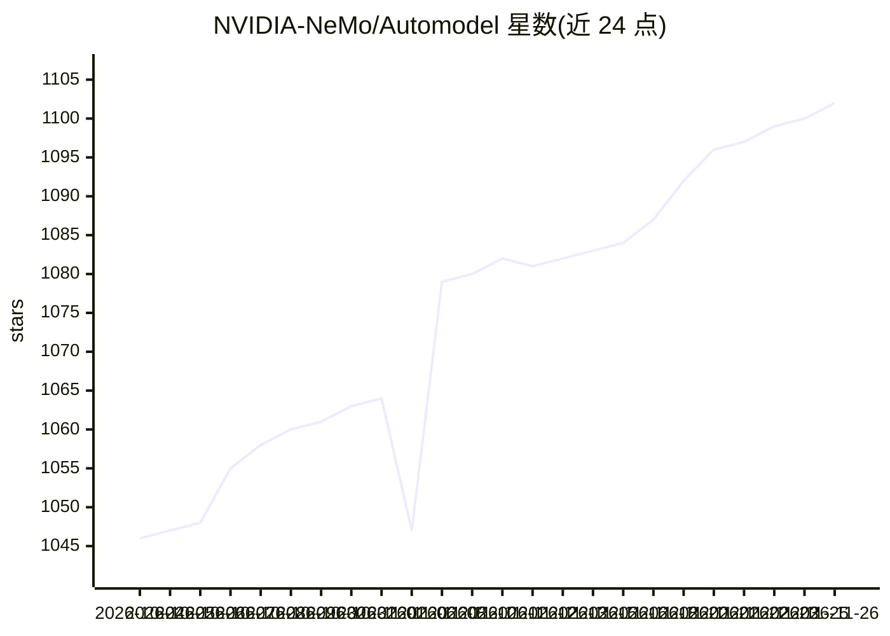

# NVIDIA-NeMo/Automodel

⭐ 1,102 · Python · Apache-2.0 · 推送 2026-11-25 · [GitHub](https://github.com/NVIDIA-NeMo/Automodel) · [官网](https://docs.nvidia.com/nemo/automodel/nightly) · 组织维护

**面向 LLM/VLM 的 PyTorch 分布式微调训练库**

NVIDIA 维护的 PyTorch 原生分布式训练库，为大型语言与视觉语言模型提供 SFT、LoRA、RL 与投机解码训练器（drafter）训练支持，开箱支持 Hugging Face 格式模型。通过 FSDP2、专家/流水线/上下文并行等并行策略在多 GPU/多节点上运行，以 recipe 形式给出各模型的训练配置，并提供文档、示例与模型覆盖页。需要 NVIDIA GPU 环境。

## 筛选速览

| 维度 | 判定 | 备注 |
|---|---|---|
| AI 角色 | `ai-ecosystem` | LLM/agent 周边工具 |
| 许可风险 | `permissive` | Apache-2.0 |
| 部署形态 | `self-host` | docker 或自建部署 |
| 模型依赖 | — | README 未给出锁定关系 |
| 硬件要求 | — | 无带数字的原话,不猜 |
| 安装摩擦 | `low` | 无编译、无系统依赖或容器化 |
| 成熟度 | — | 结构信号不足 |

## 能力要点

- 提供 SFT、LoRA 与 RL（REINFORCE-Zero 等路线）训练能力
- 支持 FSDP2 与专家/流水线/上下文并行
- 开箱支持 Hugging Face 格式模型并提供各模型 recipe
- 支持 EAGLE、DFlash 等投机解码 drafter 的端到端训练

## 适用场景

- 在多 GPU 集群上对 LLM/VLM 做全参数或 LoRA 微调
- 按现成 recipe 复现特定模型的训练配置
- 训练投机解码 drafter 并导出到推理布局

## 场景标签

`微调` `强化学习` · 领域:训练与推理

## 证据(README 行号)

> L1: # 🚀 NeMo AutoModel
> L9: 📖 Documentation • 🔥 Ready-to-Use Recipes • 💡 Examples • Model Coverage • Performance • 🤝 Contributing
> L64: - [04/25/2026]**DeepSeek V4 Flash** We now support finetuning `deepseek-ai/DeepSeek-V4-Flash`, thanks to @Khazic. C

## 星数曲线

2026-10-24 1,046 → 2026-11-26 1,102（+56）

---
*卡片 v1 · prompt 1.4 · 生成 2026-11-24 · 置信度 high · 依据 README sha `57745f074a41` · [字段定义](../../DATASET.md)*
