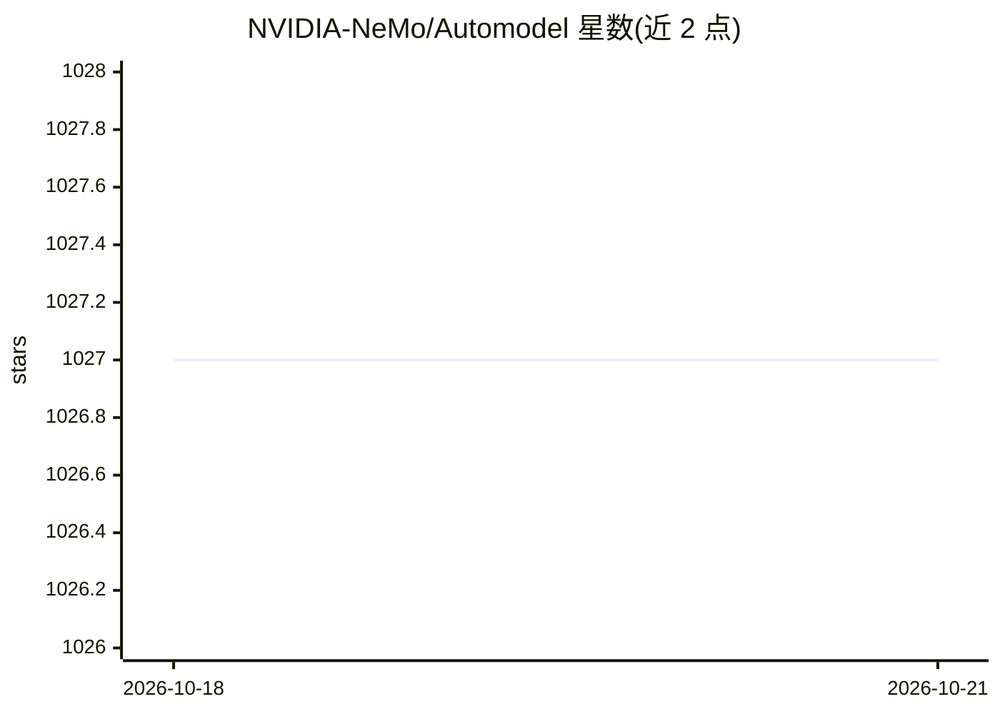

# NVIDIA-NeMo/Automodel

⭐ — · [GitHub]() · 组织维护

**面向 LLM/VLM 等的 PyTorch 分布式训练与微调库**

NVIDIA NeMo 框架下的开源训练库，基于 PyTorch DTensor 原生 SPMD 模式，提供 LLM、VLM、扩散模型与检索模型的训练及微调能力，支持 LoRA 与全参数微调，覆盖 FSDP2、专家/流水线/上下文并行等分布式策略，并带开箱即用的 Hugging Face 模型适配（README 称 day-0 支持）。使用 YAML 驱动的 recipes，可经 CLI 覆盖字段；模型覆盖包括 Qwen、GLM、DeepSeek、Kimi、Gemma、Nemotron 等系列，另含投机解码 drafter 训练与 skills/ 目录下的 agent 辅助技能。适用于研究与生产环境的单机到多 GPU 多节点场景。

## 筛选速览

| 维度 | 判定 | 备注 |
|---|---|---|
| AI 角色 | `ai-ecosystem` | LLM/agent 周边工具 |
| 许可风险 | `permissive` | — |
| 部署形态 | `library` | 以包/库形式分发 |
| 模型依赖 | — | README 未给出锁定关系 |
| 硬件要求 | — | 无带数字的原话,不猜 |
| 安装摩擦 | `medium` | 含编译或系统依赖之一 |
| 成熟度 | — | 结构信号不足 |

## 能力要点

- LoRA 与全参数微调，覆盖大量开源 LLM/VLM/文生图模型
- YAML 驱动 recipes，CLI 可覆盖任意字段
- FSDP2、专家/流水线/上下文/张量并行等分布式训练策略
- 投机解码 drafter（EAGLE-1/2/3、P-EAGLE、DFlash 等）端到端训练

## 适用场景

- 对开源大模型做 LoRA 或全参数微调
- 在多 GPU/多节点集群上运行现成训练 recipes
- 为新发布的开源模型快速接入训练流程

## 场景标签

`微调` `模型训练` · 领域:训练与推理

## 证据(README 行号)

> L86: Nemo AutoModel is a Pytorch DTensor‑native SPMD open-source training library under NVIDIA NeMo Framework, designed 
> L81: - [9/22/2025] Fine-tune Hugging Face Models Instantly with Day-0 Support with NVIDIA NeMo AutoModel

## 星数曲线

2026-10-18 1,027 → 2026-10-21 1,027（+0）

---
*卡片 v1 · prompt 1.4 · 生成 2026-10-21 · 置信度 high · 依据 README sha `9af22b4040ac` · [字段定义](../../DATASET.md)*
