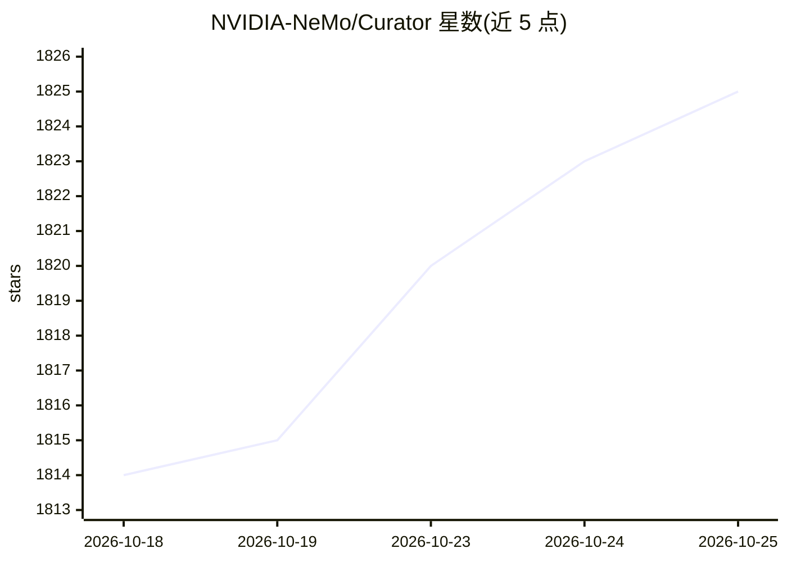

# NVIDIA-NeMo/Curator

⭐ 1,825 · Python · Apache-2.0 · 推送 2026-10-25 · [GitHub](https://github.com/NVIDIA-NeMo/Curator) · 组织维护

**面向 ML 工程师的 GPU 加速多模态数据清洗策展工具**

NVIDIA NeMo 套件中的数据预处理与策展库：以可组合的 stage 构建流水线，对大规模文本、图像、视频、音频数据集执行加载、过滤、去重、分类与转换，供 AI 训练使用；同一流水线可运行于笔记本或多节点集群（Ray/Cosmos-Xenna 执行器、Slurm 部署）。GPU 路径要求 Linux x86_64、CUDA 12 与约 16GB 显存，text_cuda12 需用 uv 安装并应用 override 文件；标准 pip 对该 extra 不支持。Nemotron 系列模型的预训练数据管线即由其驱动。

## 筛选速览

| 维度 | 判定 | 备注 |
|---|---|---|
| AI 角色 | `ai-ecosystem` | LLM/agent 周边工具 |
| 许可风险 | `permissive` | Apache-2.0 |
| 部署形态 | `self-host` | docker 或自建部署 |
| 模型依赖 | — | README 未给出锁定关系 |
| 硬件要求 | `gpu-8g` | |
| 安装摩擦 | `low` | 无编译、无系统依赖或容器化 |
| 成熟度 | — | 结构信号不足 |

## 能力要点

- 文本/图像/视频/音频四模态的模态化 stage 构件
- Stage 声明资源需求，执行器自动扩缩副本，流式执行重叠 CPU/GPU 工作
- 内置推理服务器：流水线内启动 OpenAI 兼容端点用于分类与合成数据生成
- 提供 Nemotron-CC 端到端复现等 recipes 与教程

## 适用场景

- 构建可重复的大规模训练数据策展流水线而非一次性脚本
- 对 Common Crawl 类语料做质量过滤与多级去重
- 构建图像美学/NSFW 过滤、视频场景检测、音频 ASR 数据集
- 在 Slurm/Kubernetes 多节点 HPC 环境运行策展任务

## 场景标签

`模型训练` `MLOps` · 领域:训练与推理

## 证据(README 行号)

> L10: **NeMo Curator helps ML engineers and data teams build repeatable, GPU-accelerated pipelines that load, filter, ded
> L22: |**Inference Server**|Spin up an OpenAI-compatible LLM endpoint inside your pipeline for SDG, classification, and s

## 星数曲线

2026-10-18 1,814 → 2026-10-25 1,825（+11）

---
*卡片 v1 · prompt 1.4 · 生成 2026-10-21 · 置信度 high · 依据 README sha `0f38e3a04c64` · [字段定义](../../DATASET.md)*
