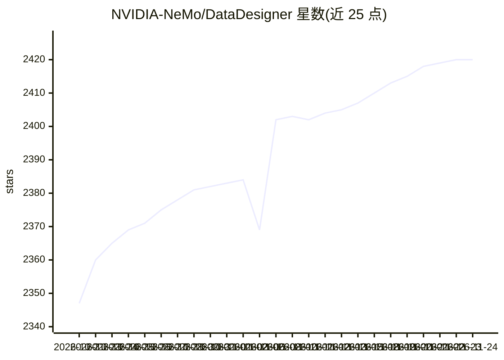

# NVIDIA-NeMo/DataDesigner

⭐ 2,420 · Python · Apache-2.0 · 推送 2026-11-21 · [GitHub](https://github.com/NVIDIA-NeMo/DataDesigner) · [官网](https://docs.nvidia.com/nemo/datadesigner) · 组织维护

**面向开发者的多模态合成数据生成框架**

NVIDIA NeMo 平台下的 Python 库，用于从零或基于种子数据生成合成数据集：支持采样器、LLM 列、图像模型生成文本、结构化数据与图像，通过依赖感知生成控制字段间关系，用 Python/SQL/自定义校验器和 LLM judge 校验打分输出，并可通过本地或远程 MCP 服务器接入外部工具并记录交互轨迹。提供插件机制扩展数据源与生成能力，支持预览、恢复与监控生成过程。通过 pip 安装，使用 NVIDIA Build、OpenAI 或 OpenRouter 等 API key 调用模型。

## 筛选速览

| 维度 | 判定 | 备注 |
|---|---|---|
| AI 角色 | `ai-native` | 本体是模型或模型工具 |
| 许可风险 | `permissive` | Apache-2.0 |
| 部署形态 | `library` | 以包/库形式分发 |
| 模型依赖 | locked-api |  |
| 硬件要求 | — | 无带数字的原话,不猜 |
| 安装摩擦 | `medium` | 含编译或系统依赖之一 |
| 成熟度 | — | 结构信号不足 |

## 能力要点

- 采样器+LLM/图像模型的多模态生成（文本、结构化数据、图像、音视频上下文）
- 依赖感知的字段关系控制与 Python/SQL/LLM judge 校验打分
- 本地/远程 MCP 服务器工具调用与交互轨迹捕获
- 插件机制（GitHub 种子读取、检索训练 SDG 工具包）与 CLI 管理

## 适用场景

- 为模型训练生成从零构建或基于种子数据的合成数据集
- 生成带统计分布与字段相关性的结构化数据
- 为检索器训练生成问答数据并导出训练格式

## 场景标签

 · 领域:AI 数据基础设施/合成数据生成

## 证据(README 行号)

> L7: **Generate high-quality synthetic datasets from scratch or using your own seed data.**
> L17: - **Generate diverse text, structured data, and images** using samplers, LLMs, image models, or existing seed datas
> L13: Data Designer helps you create synthetic datasets that go beyond simple LLM prompting. Whether you need diverse sta

## 星数曲线

2026-10-21 2,347 → 2026-11-24 2,420（+73）

---
*卡片 v1 · prompt 1.4 · 生成 2026-11-23 · 置信度 high · 依据 README sha `3e27c34bebe0` · [字段定义](../../DATASET.md)*
