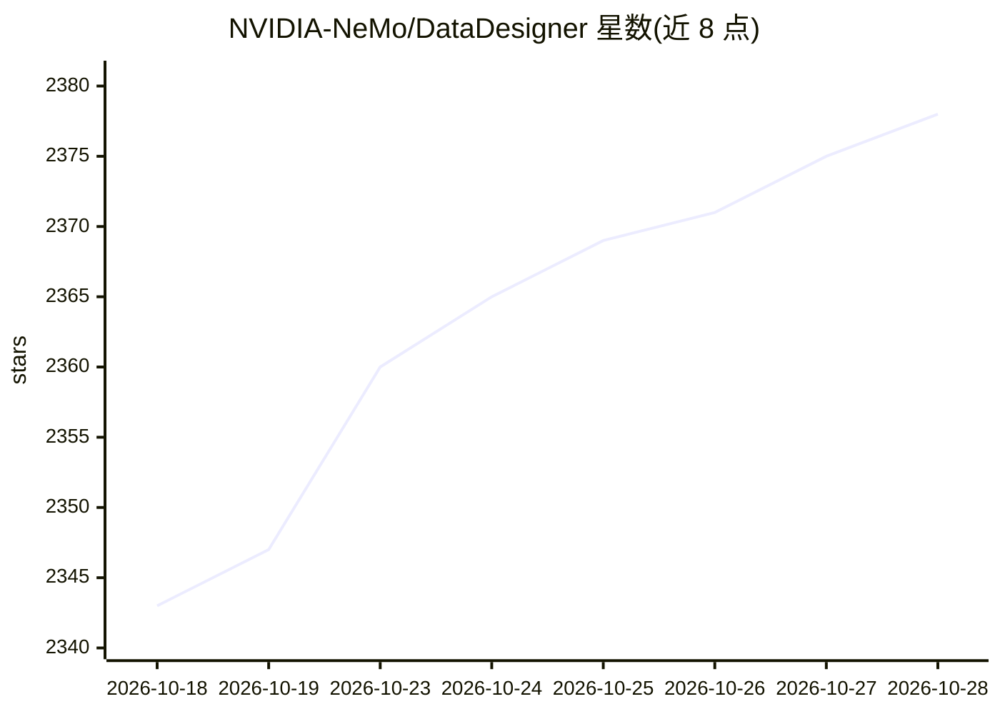

# NVIDIA-NeMo/DataDesigner

⭐ 2,378 · Python · Apache-2.0 · 推送 2026-10-27 · [GitHub](https://github.com/NVIDIA-NeMo/DataDesigner) · [官网](https://docs.nvidia.com/nemo/datadesigner) · 组织维护

**面向开发者的多模态合成数据生成框架**

NVIDIA NeMo 团队维护的合成数据生成 Python 框架：通过采样器、LLM、图像模型或种子数据集生成文本、结构化数据与图像，支持依赖感知的字段关系控制、Python/SQL/LLM 裁判验证，以及经 MCP 服务器连接外部工具并捕获交互轨迹。可安装 NVIDIA 官方插件包扩展数据源与处理能力，提供 CLI 配置模型与插件管理。默认支持 NVIDIA Build、OpenAI、OpenRouter 作为模型提供方，需设置 API key。以 pip 包与源码两种方式安装，Apache 2.0 许可，附带技术报告。

## 筛选速览

| 维度 | 判定 | 备注 |
|---|---|---|
| AI 角色 | `ai-ecosystem` | LLM/agent 周边工具 |
| 许可风险 | `permissive` | Apache-2.0 |
| 部署形态 | `library` | 以包/库形式分发 |
| 模型依赖 | — | README 未给出锁定关系 |
| 硬件要求 | — | 无带数字的原话,不猜 |
| 安装摩擦 | `medium` | 含编译或系统依赖之一 |
| 成熟度 | — | 结构信号不足 |

## 能力要点

- 采样器+LLM+图像模型生成多模态合成数据，支持字段间依赖关系控制
- Python/SQL/自定义验证器与 LLM 裁判对输出打分
- 通过本地或远程 MCP 服务器连接外部工具并捕获交互轨迹
- 插件体系（data-designer plugin install）扩展数据源与处理步骤

## 适用场景

- 从零或从种子数据批量生成训练/评测用合成数据集
- 构建带验证与打分的生产级合成数据流水线
- 为检索模型训练生成问答数据（Retrieval SDG 插件）

## 场景标签

 · 领域:AI 数据工程/合成数据生成

## 证据(README 行号)

> L13: Data Designer helps you create synthetic datasets that go beyond simple LLM prompting. Whether you need diverse sta
> L17: - **Generate diverse text, structured data, and images** using samplers, LLMs, image models, or existing seed datas
> L21: - **Validate and score outputs** with Python, SQL, custom validators, and LLM judges

## 星数曲线

2026-10-18 2,343 → 2026-10-28 2,378（+35）

---
*卡片 v1 · prompt 1.4 · 生成 2026-10-21 · 置信度 mid · 依据 README sha `7a3b78345799` · [字段定义](../../DATASET.md)*
