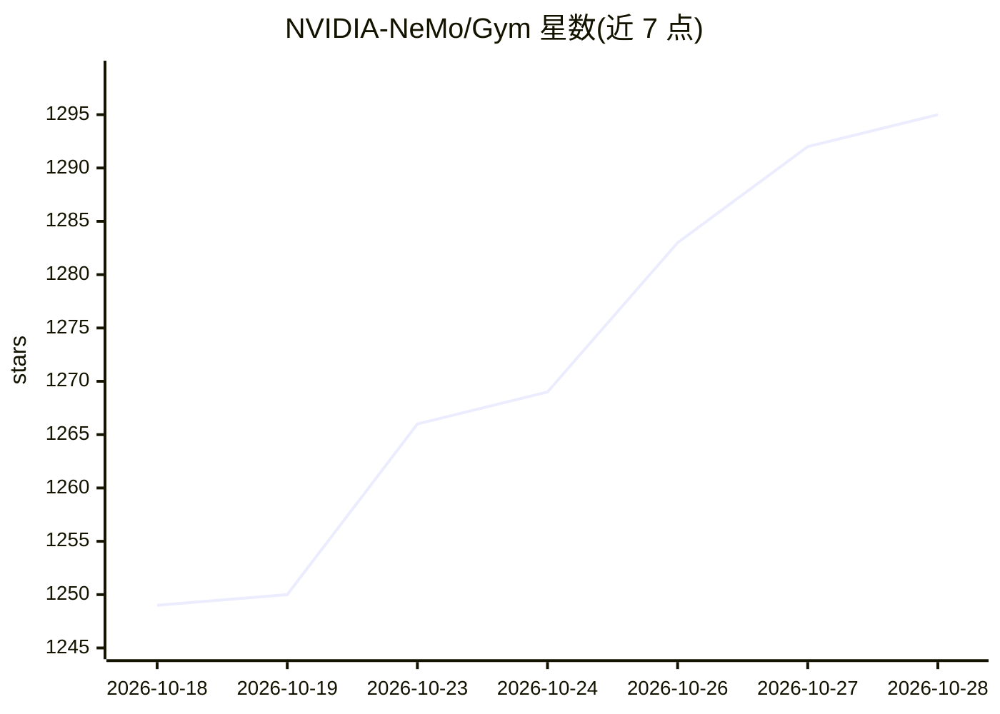

# NVIDIA-NeMo/Gym

⭐ 1,295 · Python · Apache-2.0 · 推送 2026-10-27 · [GitHub](https://github.com/NVIDIA-NeMo/Gym) · [官网](https://docs.nvidia.com/nemo/gym/main/about/) · 组织维护

**评测与训练模型/智能体的环境库**

NVIDIA NeMo 生态下的评测与训练基础设施库：以『环境』为核心抽象（数据集+智能体挂具+验证器+执行状态），提供可扩展接口、基准环境库、并发数千环境的规模化运行，以及与自选 RL 框架衔接的训练流程。内置多种 agent harness 与沙箱后端（Docker、OpenSandbox 等），支持 vLLM 本地/托管推理与 OpenTelemetry 追踪。面向需要在有状态环境中做可复现评测或大规模 RL 训练的开发团队；库本身无需 GPU，Python 3.13+ 通过 git clone + uv 安装。

## 筛选速览

| 维度 | 判定 | 备注 |
|---|---|---|
| AI 角色 | `ai-ecosystem` | LLM/agent 周边工具 |
| 许可风险 | `permissive` | Apache-2.0 |
| 部署形态 | `library` | 以包/库形式分发 |
| 模型依赖 | local-ok | 支持本地模型 |
| 硬件要求 | `cpu-ok` | |
| 安装摩擦 | `low` | 无编译、无系统依赖或容器化 |
| 成熟度 | — | 结构信号不足 |

## 能力要点

- 环境抽象=数据集+agent 挂具+验证器+状态，模块化可扩展
- 并发扩展至数千环境，衔接自选 RL 框架做训练
- 多种沙箱后端（Docker/OpenSandbox/Enroot 等）与内置 agent 挂具
- vLLM/Megatron token 级训练轨迹捕获，Slurm 断点恢复调度

## 适用场景

- 在代码执行、工具调用等有状态环境中评测模型或 agent
- 团队间用共享环境与验证器做可复现评测
- 大规模并发跑评测与 RL 训练任务

## 场景标签

`模型评测` `强化学习` · 领域:评测与运维

## 证据(README 行号)

> L11: NeMo Gym is a library for evaluating and improving models and agents using environments. NeMo Gym provides infrastr
> L30: - Train with the RL framework of your choice

## 星数曲线

2026-10-18 1,249 → 2026-10-28 1,295（+46）

---
*卡片 v1 · prompt 1.4 · 生成 2026-10-21 · 置信度 mid · 依据 README sha `4cdb649dba17` · [字段定义](../../DATASET.md)*
