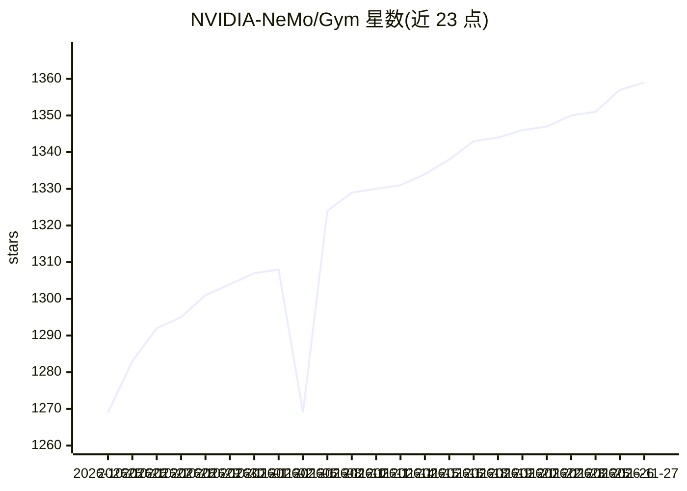

# NVIDIA-NeMo/Gym

⭐ 1,359 · Python · Apache-2.0 · 推送 2026-11-26 · [GitHub](https://github.com/NVIDIA-NeMo/Gym) · [官网](https://docs.nvidia.com/nemo/gym/main/about/) · 组织维护

**模型与 agent 的环境化评估/训练基础设施库**

NeMo Gym 是 NVIDIA NeMo 生态中用于评估与训练模型和 agent 的库：以环境（数据集+agent harness+verifier+状态）为核心抽象，提供环境开发接口、可扩展的评估/训练运行设施（Slurm 调度、多任务并发、OpenTelemetry 追踪），以及内置的基准与训练环境集合。通过 gym CLI 启动本地服务器协调模型、agent 与验证。GPU 非库运行必需，评估推理经外部 API 或 vLLM 等自托管模型完成；部分环境训练数据尚未公开。

## 筛选速览

| 维度 | 判定 | 备注 |
|---|---|---|
| AI 角色 | `ai-ecosystem` | LLM/agent 周边工具 |
| 许可风险 | `permissive` | Apache-2.0 |
| 部署形态 | `library` | 以包/库形式分发 |
| 模型依赖 | local-ok | 支持本地模型 |
| 硬件要求 | `cpu-ok` | |
| 安装摩擦 | `low` | 无编译、无系统依赖或容器化 |
| 成熟度 | — | 结构信号不足 |

## 能力要点

- 环境=数据集+agent harness+verifier+状态的可复用抽象
- 统一 gym CLI 运行评估与训练，可扩展到数千并发环境
- 接入 NeMo RL/Unsloth/VeRL 等训练框架与多类沙箱
- 内置环境中心：多领域基准与训练环境集合

## 适用场景

- 在带状态环境中评估模型或 agent（代码执行、工具调用）
- 团队间用共享环境与验证器做可复现评估
- 为 SFT/RL 训练批量生成环境交互轨迹
- 构建自定义评估或训练环境

## 场景标签

`模型评测` `强化学习` `Agent 框架` · 领域:Agent 开发

## 证据(README 行号)

> L11: NeMo Gym is a library for evaluating and improving models and agents using environments. NeMo Gym provides infrastr
> L17: - You need to **evaluate models or agents** in stateful environments (e.g. code execution, tool calling, sandboxes)

## 星数曲线

2026-10-25 1,269 → 2026-11-27 1,359（+90）

---
*卡片 v1 · prompt 1.4 · 生成 2026-11-26 · 置信度 mid · 依据 README sha `a92fcf3cd226` · [字段定义](../../DATASET.md)*
