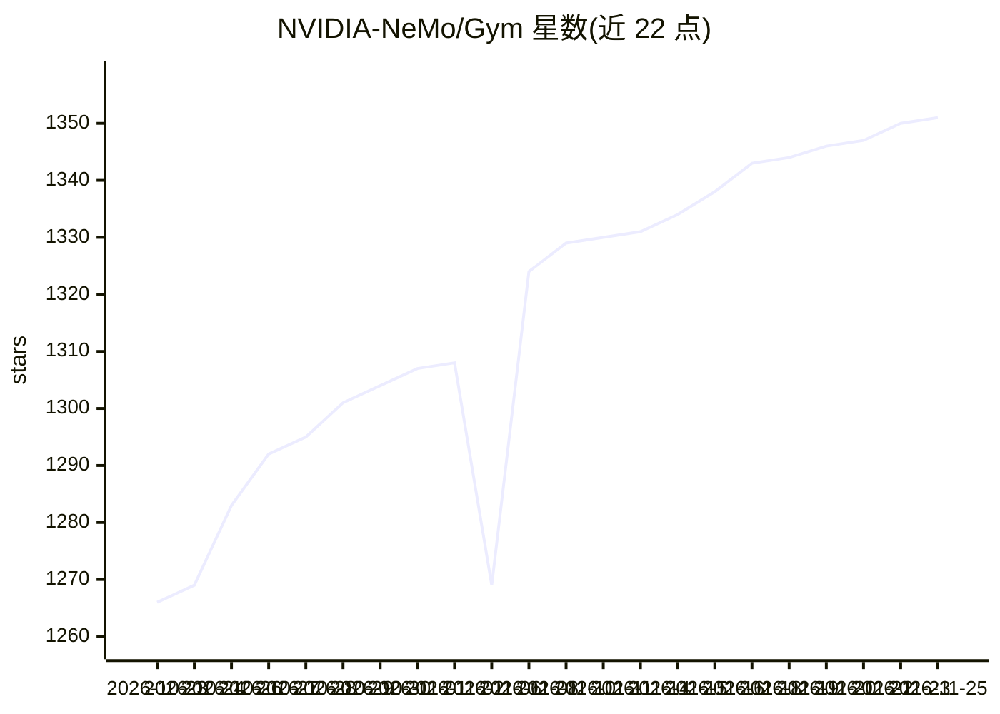

# NVIDIA-NeMo/Gym

⭐ 1,351 · Python · Apache-2.0 · 推送 2026-11-24 · [GitHub](https://github.com/NVIDIA-NeMo/Gym) · [官网](https://docs.nvidia.com/nemo/gym/main/about/) · 组织维护

**面向开发者的模型与 agent 环境化评测/训练框架**

NVIDIA NeMo 生态中的 Python 库，通过「环境」统一评测与训练：每个环境由任务数据集、agent harness、verifier 与状态组成。提供环境开发接口、可扩展运行的本地服务器、常用基准与训练环境集合，支持从评测过渡到 SFT/RL 训练，并可接入外部训练框架与 agent harness。requirements 标注无需 GPU，需 Python 3.13.14+ 与 Git，通过 git clone 与 uv 安装，另提供容器镜像。

## 筛选速览

| 维度 | 判定 | 备注 |
|---|---|---|
| AI 角色 | `ai-ecosystem` | LLM/agent 周边工具 |
| 许可风险 | `permissive` | Apache-2.0 |
| 部署形态 | `library` | 以包/库形式分发 |
| 模型依赖 | local-ok | 支持本地模型 |
| 硬件要求 | `cpu-ok` | |
| 安装摩擦 | `low` | 无编译、无系统依赖或容器化 |
| 成熟度 | — | 结构信号不足 |

## 能力要点

- 模块化 agent/环境/任务/verifier 接口与环境中心
- 支持大规模并发评测与训练（数千并发环境）
- 可搭配 NeMo RL、Unsloth、VeRL 等训练框架
- 内置多种 agent harness（OpenHands、Mini SWE Agent、LangGraph 等）

## 适用场景

- 在有状态环境中评测模型或 agent（代码执行、工具调用、沙箱）
- 团队间用共享环境与 verifier 做可复现评测
- 对 agent 进行 SFT 或 RL 训练
- 自建自定义评测/训练环境

## 场景标签

`Agent 框架` `模型评测` `强化学习` `微调` · 领域:Agent 开发

## 证据(README 行号)

> L11: NeMo Gym is a library for evaluating and improving models and agents using environments. NeMo Gym provides infrastr
> L38: NeMo Gym is a component of NVIDIA NeMo, a GPU-accelerated platform for training generative AI models and optimizing

## 星数曲线

2026-10-23 1,266 → 2026-11-25 1,351（+85）

---
*卡片 v1 · prompt 1.4 · 生成 2026-11-23 · 置信度 mid · 依据 README sha `57ecab79d412` · [字段定义](../../DATASET.md)*
