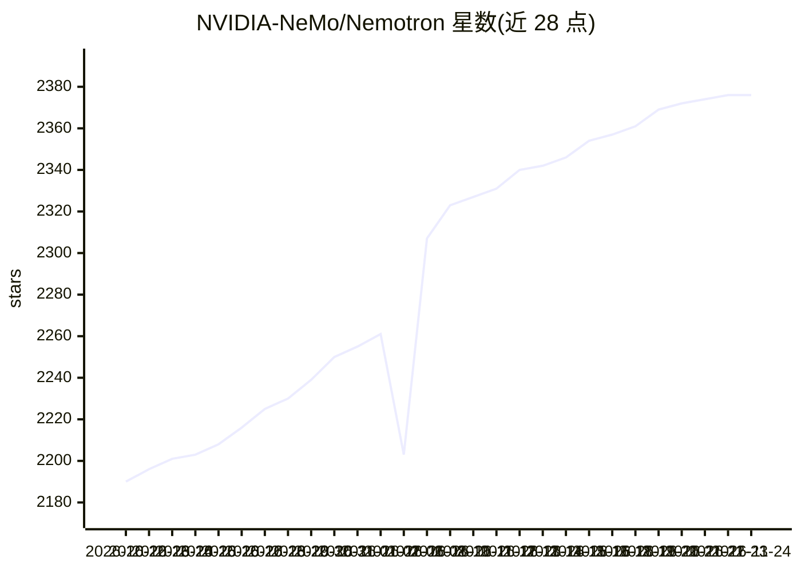

# NVIDIA-NeMo/Nemotron

⭐ 2,376 · Jupyter Notebook · Apache-2.0 · 推送 2026-11-20 · [GitHub](https://github.com/NVIDIA-NeMo/Nemotron) · [官网](https://docs.nvidia.com/nemotron/latest/index.html) · 组织维护

**NVIDIA Nemotron 模型的训练配方、用例与数据集资源库**

NVIDIA Nemotron 模型家族的开发者资源库，包含四部分：nemotron steps CLI 与 YAML 配置组成的训练/评估/合成数据模块、可复现的端到端训练配方（预训练/SFT/RL 全流程）、部署与推理用法的 Jupyter cookbook、以及端到端应用示例。仓库附带 nemotron-customize 的 Claude Code 插件，可从步骤目录规划 DAG 并生成流水线 YAML。训练配方仅使用开源数据子集，结果与技术报告基准存在差异。

## 筛选速览

| 维度 | 判定 | 备注 |
|---|---|---|
| AI 角色 | `ai-knowledge` | 知识聚合/清单类 |
| 许可风险 | `permissive` | Apache-2.0 |
| 部署形态 | `None` |  |
| 模型依赖 | local-ok | 支持本地模型 |
| 硬件要求 | — | 无带数字的原话,不猜 |
| 安装摩擦 | `low` | 无编译、无系统依赖或容器化 |
| 成熟度 | — | 结构信号不足 |

## 能力要点

- nemotron steps CLI 提供数据准备、SDG、SFT/PEFT/RL、评估等模块化步骤
- 多款模型的完整训练配方，含参数规模与阶段划分
- 部署支持 NeMo、TensorRT-LLM、vLLM、SGLang、NIM
- 随附 Claude Code 插件 nemotron-customize 生成流水线配置

## 适用场景

- 按官方配方复现或微调 Nemotron 系列模型
- 用 steps CLI 组合自定义的训练/评估流水线
- 查找模型的部署与推理使用指南
- 构建 RAG、agent、工具调用等端到端应用

## 场景标签

`微调` `模型训练` `强化学习` · 领域:训练与推理

## 证据(README 行号)

> L3: **Open and efficient models for agentic AI.** Training recipes, deployment guides, and use-case examples for the Nem
> L74: |**When to use**|You want to run one stage in isolation or compose a custom pipeline|You want to train, fine-tune, 
> L122: The Nemotron repository provides reproducible training pipelines from raw data to deployment-ready models. These i

## 星数曲线

2026-10-22 2,190 → 2026-11-24 2,376（+186）

---
*卡片 v1 · prompt 1.4 · 生成 2026-11-23 · 置信度 high · 依据 README sha `7e17033c6b75` · [字段定义](../../DATASET.md)*
