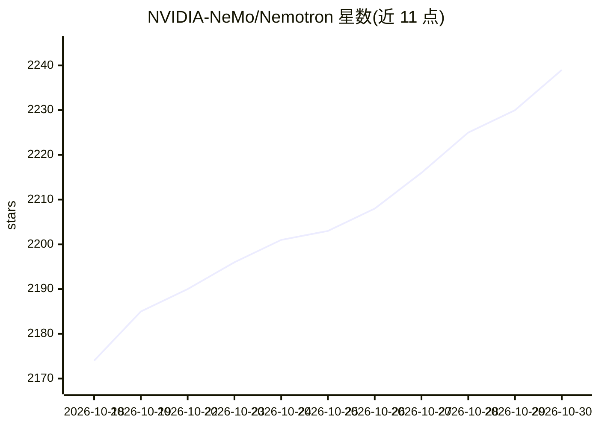

# NVIDIA-NeMo/Nemotron

⭐ 2,239 · Jupyter Notebook · Apache-2.0 · 推送 2026-10-28 · [GitHub](https://github.com/NVIDIA-NeMo/Nemotron) · [官网](https://docs.nvidia.com/nemotron/latest/index.html) · 组织维护

**NVIDIA Nemotron 模型开发者资源库：训练配方、步骤与用例集**

NVIDIA 官方维护的 Nemotron 模型家族开发者资源库，面向构建与训练大模型的工程师和研究人员。内容分四层：模块化训练步骤（nemotron steps CLI + YAML 配置，覆盖数据治理、SDG、预训练、SFT、PEFT、RL、评测）、可复现训练配方（从原始数据到部署模型的全流程管线）、部署使用手册和端到端用例示例。训练配方基于 Megatron-Bridge、Automodel、NeMo-RL 等组件，并附 Claude Code 插件。限制：配方仅使用开源数据子集训练，结果与技术报告基准不同。

## 筛选速览

| 维度 | 判定 | 备注 |
|---|---|---|
| AI 角色 | `ai-ecosystem` | LLM/agent 周边工具 |
| 许可风险 | `permissive` | Apache-2.0 |
| 部署形态 | `None` |  |
| 模型依赖 | local-ok | 支持本地模型 |
| 硬件要求 | — | 无带数字的原话,不猜 |
| 安装摩擦 | `low` | 无编译、无系统依赖或容器化 |
| 成熟度 | — | 结构信号不足 |

## 能力要点

- nemotron steps CLI 提供全训练生命周期的可复用构建块（数据治理/SDG/SFT/PEFT/RL/评测）
- 6 个模型的完整训练配方，含 550B-A55B Ultra 的 Pretrain→SFT→RL 流程
- 部署支持 NeMo、TensorRT-LLM、vLLM、SGLang 与 NIM 微服务
- 随库提供 Claude Code 插件 nemotron-customize，生成流水线 YAML 配置

## 适用场景

- 按官方配方复现或定制 Nemotron 模型训练
- 从完整管线中提取预训练/SFT/RL 的具体技术
- 在 vLLM/TensorRT-LLM 等后端部署 Nemotron 模型
- 组合单个步骤构建自定义训练流水线

## 场景标签

`模型训练` `微调` `强化学习` · 领域:训练与推理

## 证据(README 行号)

> L64: ├── src/nemotron/steps/      Modular building blocks for training, eval, SDG, and more
> L72: |**Purpose**|Full lifecycle building blocks, chain data prep, training, eval and other steps|Reproduce full trainin
> L120: The Nemotron repository provides reproducible training pipelines from raw data to deployment-ready models. These i

## 星数曲线

2026-10-18 2,174 → 2026-10-30 2,239（+65）

---
*卡片 v1 · prompt 1.4 · 生成 2026-10-21 · 置信度 high · 依据 README sha `13cb212fa7ea` · [字段定义](../../DATASET.md)*
