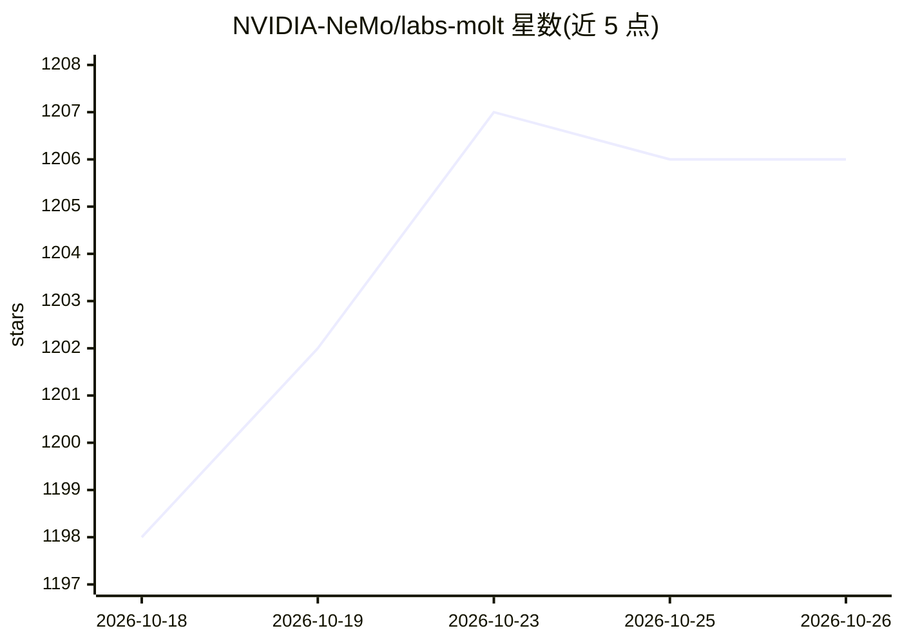

# NVIDIA-NeMo/labs-molt

⭐ 1,206 · Python · Apache-2.0 · 推送 2026-10-25 · [GitHub](https://github.com/NVIDIA-NeMo/labs-molt) · 组织维护

**面向科研的 agentic-first 强化学习训练框架（PyTorch/HF 原生）**

NVIDIA NeMo Labs 出品的大模型 RL/SFT 训练框架：agent 即程序，通过 Gymnasium 风格的 Env.step()/ChatAgent.run() 定义环境与奖励（支持多轮工具调用、VLM 环境、LLM-as-judge）。运行时由 Ray 负责部署与异步队列、vLLM 负责 rollout、NVIDIA AutoModel + FSDP2 负责纯 PyTorch 训练，约 9.2K 行代码声称可扩展到 1T 级 MoE。推荐 Docker 容器安装（含 CUDA 13 全栈，适配 A100/H100/H200/B200/GB200）；本地 pip 安装要求 CUDA 13 与驱动 580+，PyPI 包当前非受支持路径。面向需要阅读并修改训练代码的研究者。

## 筛选速览

| 维度 | 判定 | 备注 |
|---|---|---|
| AI 角色 | `ai-ecosystem` | LLM/agent 周边工具 |
| 许可风险 | `permissive` | Apache-2.0 |
| 部署形态 | `self-host` | docker 或自建部署 |
| 模型依赖 | local-ok | 支持本地模型 |
| 硬件要求 | — | 无带数字的原话,不猜 |
| 安装摩擦 | `low` | 无编译、无系统依赖或容器化 |
| 成熟度 | — | 结构信号不足 |

## 能力要点

- Gymnasium 对齐的单 agent API，奖励为任意 Python 代码
- Ray 异步队列 + vLLM rollout + AutoModel/FSDP2 训练三层栈
- 支持 TP/EP/CP 并行、MoE、多模态 VLM RL 与多轮工具调用
- 提供 FlashREINFORCE、on-policy 蒸馏、MoE 路由冻结等 RL 开关

## 适用场景

- 在自建环境与奖励函数上做多轮 agentic RL 实验
- 对大规模 MoE 模型（DeepSeek 级）做 SFT 到 RL 训练
- 阅读并修改端到端 RL 训练代码进行研究迭代

## 场景标签

`强化学习` `科研工具` `微调` · 领域:学习与行业

## 证据(README 行号)

> L3: **An agentic-first RL framework for research.**
> L5: Ray · vLLM · NVIDIA AutoModel — the smallest PyTorch / HuggingFace-native stack for
> L39: **vLLM** for rollout, **NVIDIA AutoModel + FSDP2** for training in pure

## 星数曲线

2026-10-18 1,198 → 2026-10-26 1,206（+8）

---
*卡片 v1 · prompt 1.4 · 生成 2026-10-21 · 置信度 mid · 依据 README sha `be41a71500cc` · [字段定义](../../DATASET.md)*
