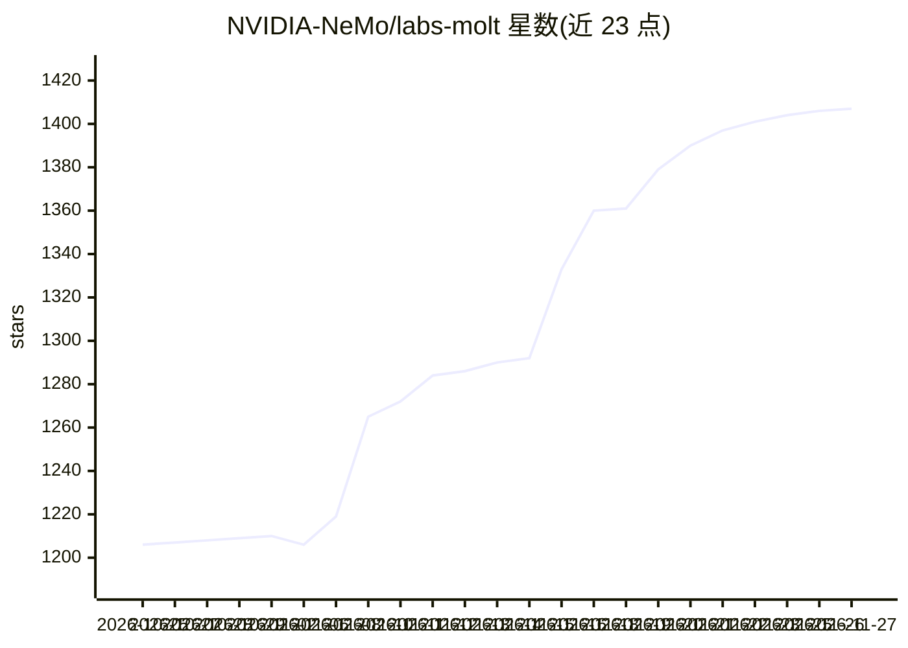

# NVIDIA-NeMo/labs-molt

⭐ 1,407 · Python · Apache-2.0 · 推送 2026-11-26 · [GitHub](https://github.com/NVIDIA-NeMo/labs-molt) · [官网](https://nvidia-nemo.github.io/labs-molt/) · 组织维护

**面向 RL 研究者的 Hugging Face 原生 agentic 强化学习框架**

由 NVIDIA NeMo 团队维护的 agentic RL 训练框架，约 9.2K 行 RL 代码。用户用 Python 编写 Env 或 ChatAgent 定义奖励（评分器、多轮工具循环、VLM 环境、LLM judge），Ray 负责进程编排与异步队列，vLLM 生成 rollout，NeMo AutoModel + FSDP2 训练单个 actor。模型保持 HF 布局的 PyTorch 模块，一份 checkpoint 同时服务 vLLM 与训练器，支持 TP/EP/CP 并行与 Adam CPU offload，官方 Docker 镜像预装 CUDA 13 全套依赖，要求 CUDA 12 环境不可用。

## 筛选速览

| 维度 | 判定 | 备注 |
|---|---|---|
| AI 角色 | `ai-ecosystem` | LLM/agent 周边工具 |
| 许可风险 | `permissive` | Apache-2.0 |
| 部署形态 | `self-host` | docker 或自建部署 |
| 模型依赖 | local-ok | 支持本地模型 |
| 硬件要求 | — | 无带数字的原话,不猜 |
| 安装摩擦 | `low` | 无编译、无系统依赖或容器化 |
| 成熟度 | — | 结构信号不足 |

## 能力要点

- Gymnasium 风格 Env/ChatAgent API，奖励为任意 Python 代码
- 全异步运行时：rollout、训练与权重同步重叠执行
- HF 原生 checkpoint，vLLM 与训练器共享同一目录
- 单 actor 架构，RL 代码约 9.2K 行，支持 1T 级 MoE

## 适用场景

- 对 LLM/VLM agent 做多轮工具调用的 RL 训练实验
- 将 4B 到数百 B 参数 MoE 模型从 SFT 训到 RL
- 在单节点到 Slurm 集群上复用同一套训练入口

## 场景标签

`强化学习` · 领域:训练与推理

## 证据(README 行号)

> L3: **A Hugging Face-native, minimal, and scalable framework for agentic RL research.**
> L38: Molt is **agentic-first**, **Hugging Face-native**, **minimal**, and **scalable**. The agent is the
> L41: places the processes and runs the async queues, **vLLM** generates the rollouts, and **NeMo

## 星数曲线

2026-10-25 1,206 → 2026-11-27 1,407（+201）

---
*卡片 v1 · prompt 1.4 · 生成 2026-11-23 · 置信度 mid · 依据 README sha `f041b3db75ae` · [字段定义](../../DATASET.md)*
