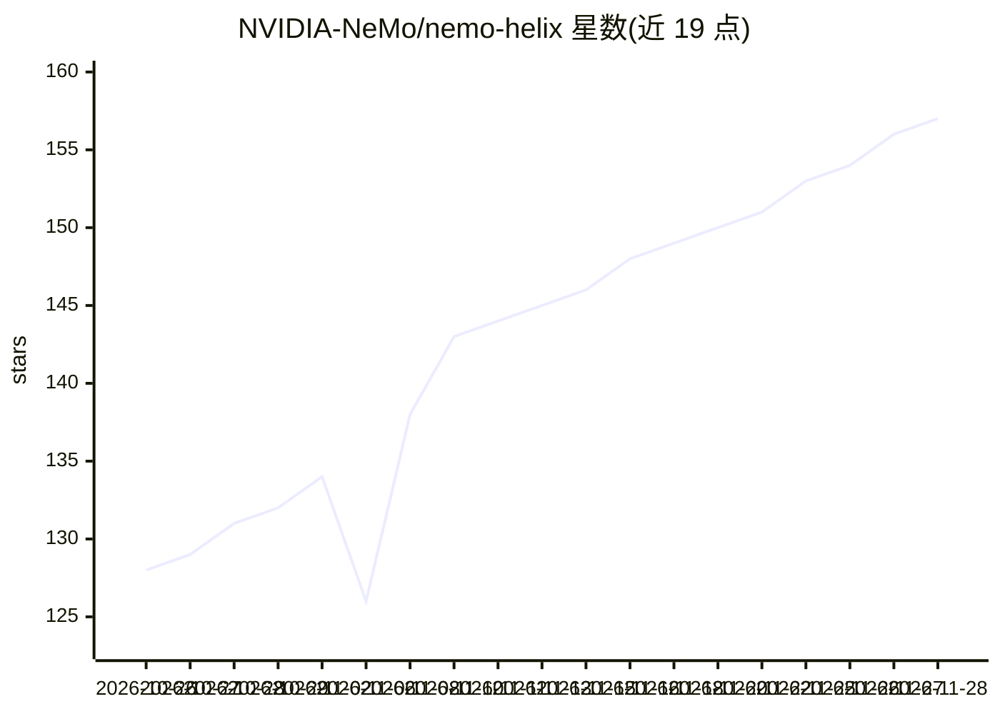

# NVIDIA-NeMo/nemo-helix

⭐ 157 · Python · Apache-2.0 · 推送 2026-11-27 · [GitHub](https://github.com/NVIDIA-NeMo/nemo-helix) · [官网](https://docs.nvidia.com/nemo-helix) · 组织维护

**面向已上线 agent 的评测与加固开源控制平面**

NeMo Helix 是部署在自有基础设施上的 agent 改进控制平面：接入 agent 运行进行可观测性与追踪采集，生成训练/评测数据，做 prompt 优化、超参搜索与模型路由，支持 LoRA/SFT/DPO/GRPO 微调，提供评测套件、LLM-as-judge 与 guardrails/garak 红队等安全能力；本地或 Kubernetes 运行，通过 CLI、REST API、Python SDK 及 NeMo Studio Web UI 访问，基础设施以可替换的模块化插件提供。

## 筛选速览

| 维度 | 判定 | 备注 |
|---|---|---|
| AI 角色 | `ai-ecosystem` | LLM/agent 周边工具 |
| 许可风险 | `permissive` | Apache-2.0 |
| 部署形态 | `library` | 以包/库形式分发 |
| 模型依赖 | local-ok | 支持本地模型 |
| 硬件要求 | — | 无带数字的原话,不猜 |
| 安装摩擦 | `low` | 无编译、无系统依赖或容器化 |
| 成熟度 | — | 结构信号不足 |

## 能力要点

- 能力覆盖观测、数据合成、优化、微调、评测与安全六大域
- 内置 Compass（生产 trace 失败定位）与 Eval Author（生成评测任务）两个 agent
- skills 可装入 Claude Code/Cursor/Codex/OpenCode 由编码 agent 驱动
- 基础设施默认实现均可替换（存储、数据库、IdP/OIDC、OpenAI 兼容网关）

## 适用场景

- 上线前对 agent 做基准评测与红队测试
- 从生产 trace 定位 agent 失败原因并转化为评测任务
- 微调与部署自定义模型并接入推理网关

## 场景标签

`模型网关` `LLM 可观测性` `模型评测` `微调` · 领域:Agent 开发

## 证据(README 行号)

> L12: NeMo Helix is an open source control plane for improving and hardening production agents. It runs on your infrastru
> L103: |**Evaluation**|Score candidates against your benchmarks before you ship them|NeMo Gym environments, Harbor eval s
> L104: |**Safety**|Catch unsafe behavior before and during production|Guardrails (content safety, jailbreak detection, PI

## 星数曲线

2026-10-26 128 → 2026-11-28 157（+29）

---
*卡片 v1 · prompt 1.4 · 生成 2026-11-27 · 置信度 high · 依据 README sha `68ecdaeee5a0` · [字段定义](../../DATASET.md)*
