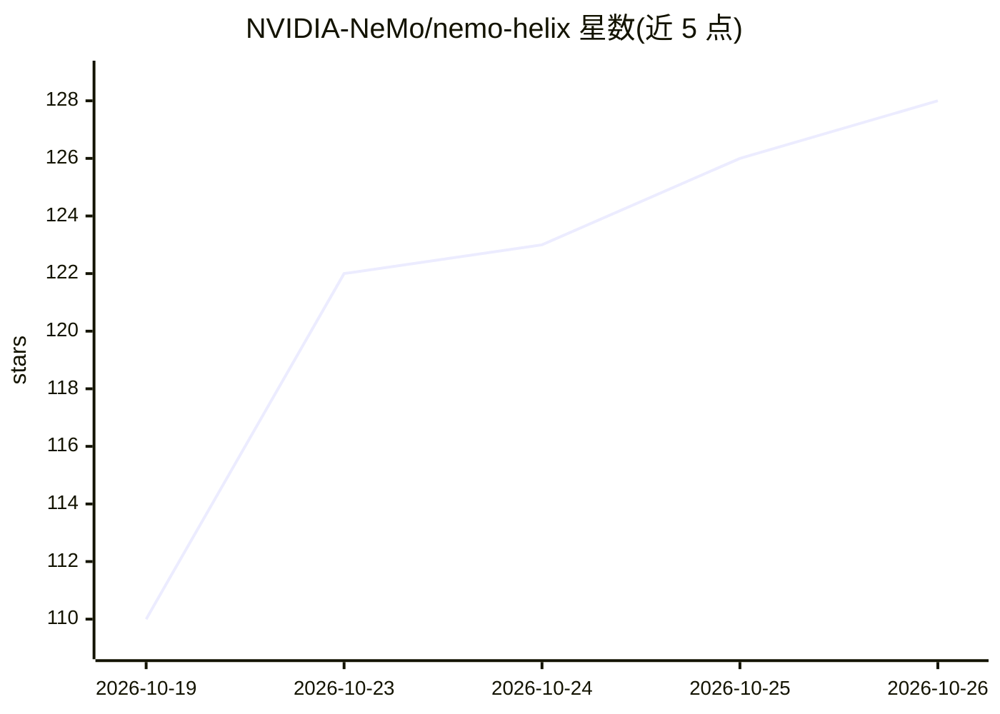

# NVIDIA-NeMo/nemo-helix

⭐ 128 · Python · Apache-2.0 · 推送 2026-10-25 · [GitHub](https://github.com/NVIDIA-NeMo/nemo-helix) · [官网](https://docs.nvidia.com/nemo-helix) · 组织维护

**生产级 AI agent 的评测、加固与编排控制平面**

NeMo Helix 是 NVIDIA 开源的 agent 控制平面，运行在用户自有基础设施上，可通过 REST API、CLI、Python SDK 与 NeMo Studio Web UI 访问。功能覆盖 agent 护栏（内容安全/越狱检测/PII 脱敏）、红队测试（garak）、LLM-as-judge 与 RAG 基准评测、技能与提示调优、基于 NAT 的 agent 构建及合成数据生成。插件化架构支持替换执行、沙箱、存储、密钥与推理中间件。本地默认模式依赖 Docker，可本地或 Kubernetes 运行。

## 筛选速览

| 维度 | 判定 | 备注 |
|---|---|---|
| AI 角色 | `ai-ecosystem` | LLM/agent 周边工具 |
| 许可风险 | `permissive` | Apache-2.0 |
| 部署形态 | `library` | 以包/库形式分发 |
| 模型依赖 | local-ok | 支持本地模型 |
| 硬件要求 | — | 无带数字的原话,不猜 |
| 安装摩擦 | `low` | 无编译、无系统依赖或容器化 |
| 成熟度 | `idea` | |

## 能力要点

- 护栏（内容安全/越狱检测/PII 脱敏）与 garak 红队测试
- LLM-as-judge、确定性、agentic 与 RAG 基准评测
- 技能/提示/超参调优与 Switchyard 模型路由
- 插件化基础设施：执行、沙箱、文件、密钥、推理网关

## 适用场景

- 对生产 agent 做行为评测与回归测试
- 为 agent 加装内容安全与 PII 护栏并做红队测试
- 通过 CLI/SDK/REST 管理模型、技能与 agent 部署

## 场景标签

`模型评测` · 领域:评测与运维

## 证据(README 行号)

> L12: NeMo Helix is an open source control plane for improving and hardening production agents. It runs on your infrastru
> L14: NeMo Helix uses modular plugins for the infrastructure agents need to run at scale. Choose the capabilities you nee
> L109: - **Evaluate agents.** LLM-as-judge, deterministic, agentic, and RAG benchmarks. Harbor-backed eval suites for reg

## 星数曲线

2026-10-19 110 → 2026-10-26 128（+18）

---
*卡片 v1 · prompt 1.4 · 生成 2026-10-23 · 置信度 high · 依据 README sha `1fa8b528baf7` · [字段定义](../../DATASET.md)*
