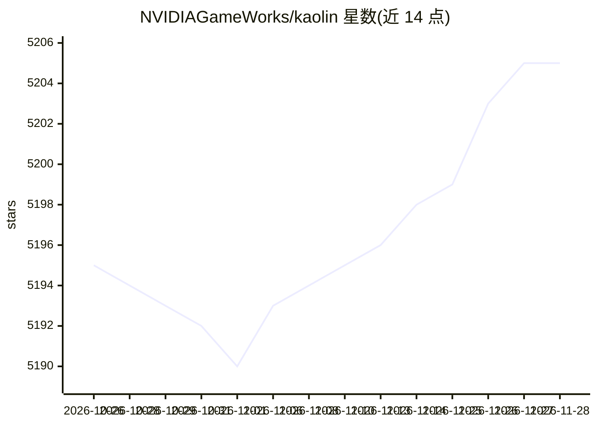

# NVIDIAGameWorks/kaolin

⭐ 5,205 · Python · Apache-2.0 · 推送 2026-11-23 · [GitHub](https://github.com/NVIDIAGameWorks/kaolin) · 组织维护

**面向 3D 深度学习科研的 PyTorch GPU 模块库**

NVIDIA 的 PyTorch 库，将 3D 深度学习研究中的可复用模块封装为 GPU 优化 API。功能覆盖 Simplicits 表征无关物理仿真（mesh/splat/点云）、可微渲染（DIB-R、nvdiffrast、easy_render PBR）、3D Gaussian splat 模型与 PLY/USD I/O、GPU 八叉树加速结构 SPC、表征间转换、四元数运算及 Jupyter/Web 可视化。面向 3D 深度学习研究者，v0.12.0 起支持预编译 wheel 安装，安装需匹配 torch 与 CUDA 版本。

## 筛选速览

| 维度 | 判定 | 备注 |
|---|---|---|
| AI 角色 | `ai-native` | 本体是模型或模型工具 |
| 许可风险 | `permissive` | Apache-2.0 |
| 部署形态 | `library` | 以包/库形式分发 |
| 模型依赖 | — | README 未给出锁定关系 |
| 硬件要求 | — | 无带数字的原话,不猜 |
| 安装摩擦 | `medium` | 含编译或系统依赖之一 |
| 成熟度 | `idea` | |

## 能力要点

- Simplicits 表征无关物理仿真（mesh/splat/点云，Warp 加速）
- 可微渲染：DIB-R、nvdiffrast、easy_render PBR 与光照模型
- 3D Gaussian splat 一等支持（PLY/USD I/O、densification、gsplat 桥接）
- GPU 八叉树加速结构 SPC 与表征间快速转换

## 适用场景

- 为 3D 重建/生成研究搭建可微渲染管线
- 对 mesh、splat、点云做物理仿真与碰撞实验
- 在 mesh、体素、点云、gaussian 间做 GPU 表征转换
- 在 Jupyter 或浏览器中交互式查看 3D 数据

## 场景标签

`科研工具` · 领域:学习与行业

## 证据(README 行号)

> L3: > **TL;DR** — Kaolin is NVIDIA's PyTorch library of reusable, GPU-optimized modules distilled from 3D deep learning 
> L26: Kaolin packages reusable building blocks from NVIDIA 3D research into a cohesive PyTorch API — continuously improvi

## 星数曲线

2026-10-26 5,195 → 2026-11-28 5,205（+10）

---
*卡片 v1 · prompt 1.4 · 生成 2026-11-22 · 置信度 high · 依据 README sha `8f9a90823306` · [字段定义](../../DATASET.md)*
