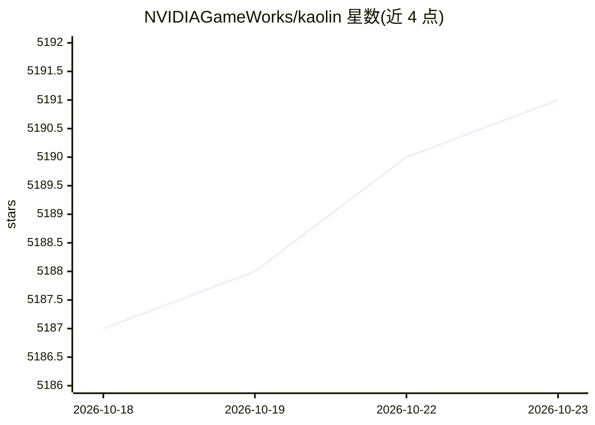

# NVIDIAGameWorks/kaolin

⭐ 5,191 · Python · Apache-2.0 · 推送 2026-10-19 · [GitHub](https://github.com/NVIDIAGameWorks/kaolin) · 组织维护

**面向 3D 深度学习研究的 PyTorch GPU 加速库**

NVIDIA 维护的 PyTorch 3D 深度学习研究库：提供表示无关的物理仿真（Simplicits，Warp 加速）、可微渲染（DIB-R/nvdiffrast/easy_render PBR）、3D 高斯泼溅模型容器与 PLY/USD I/O、GPU 八叉树加速结构（SPC）、网格/点云/体素/高斯间的快速转换、可微四元数运算、USD 管线与 Jupyter 3D 可视化。面向 3D 深度学习研究者，通过 pip 预编译 wheel 安装，需匹配 torch/CUDA 版本。

## 筛选速览

| 维度 | 判定 | 备注 |
|---|---|---|
| AI 角色 | `ai-native` | 本体是模型或模型工具 |
| 许可风险 | `permissive` | Apache-2.0 |
| 部署形态 | `library` | 以包/库形式分发 |
| 模型依赖 | — | README 未给出锁定关系 |
| 硬件要求 | — | 无带数字的原话,不猜 |
| 安装摩擦 | `medium` | 含编译或系统依赖之一 |
| 成熟度 | — | 结构信号不足 |

## 能力要点

- 表示无关物理仿真（meshes/splats/点云，Warp 加速）
- 可微渲染：DIB-R、nvdiffrast、easy_render PBR
- GaussianSplatModel 容器与 PLY/USD I/O、致密化
- GPU 八叉树结构 SPC 与多表示间快速转换

## 适用场景

- 3D 深度学习研究中做可微渲染与重建
- 对网格、高斯泼溅、点云做物理仿真
- 在 PyTorch 流水线中转换和处理多种 3D 表示

## 场景标签

`模型训练` · 领域:训练与推理

## 证据(README 行号)

> L1: # Kaolin: A PyTorch Library for Accelerating 3D Deep Learning Research
> L3: > **TL;DR** — Kaolin is NVIDIA's PyTorch library of reusable, GPU-optimized modules distilled from 3D deep learning 
> L19: Kaolin packages reusable building blocks from NVIDIA 3D research into a cohesive PyTorch API — continuously improvi

## 星数曲线

2026-10-18 5,187 → 2026-10-23 5,191（+4）

---
*卡片 v1 · prompt 1.4 · 生成 2026-10-20 · 置信度 high · 依据 README sha `9ae78f51ebed` · [字段定义](../../DATASET.md)*
