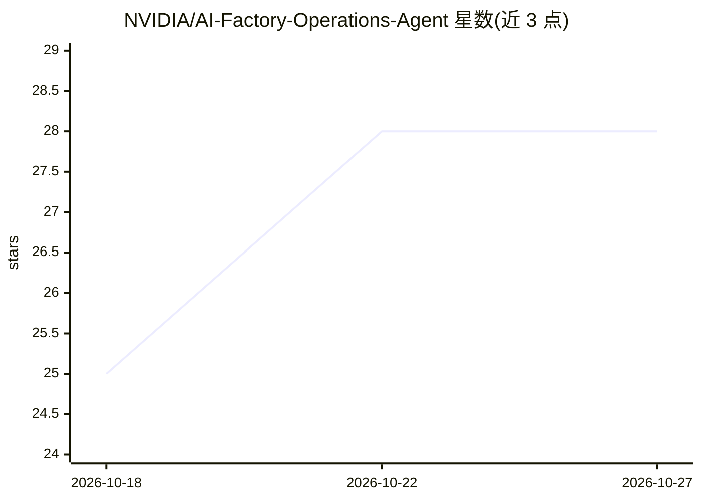

# NVIDIA/AI-Factory-Operations-Agent

⭐ 28 · TypeScript · Apache-2.0 · 推送 2026-10-26 · [GitHub](https://github.com/NVIDIA/AI-Factory-Operations-Agent) · [官网](https://build.nvidia.com/nvidia/operate-ai-factories-with-agents/) · 组织维护

**部署 AI agent 排查集群问题的 NVIDIA 运维蓝图**

NVIDIA 出品的 AI 工厂运维蓝图：基于 NemoClaw 构建可扩展的 agent 运维框架，专用 agent 在集群系统中收集并关联证据，生成根因摘要与下一步建议，工作流受治理且可审计。支持只读 Kubernetes 巡检、Prometheus/VictoriaMetrics 查询与 Grafana 看板创建、Slurm 作业根因分析、沙箱化命令执行。面向集群运维团队，通过浏览器 UI、HTTP API、CLI 与 MCP 桥四种接口调用。当前为实验性早期访问版本，需申请 NGC 私有仓库邀请方可拉取镜像。

## 筛选速览

| 维度 | 判定 | 备注 |
|---|---|---|
| AI 角色 | `ai-native` | 本体是模型或模型工具 |
| 许可风险 | `permissive` | Apache-2.0 |
| 部署形态 | `library` | 以包/库形式分发 |
| 模型依赖 | local-ok | 支持本地模型 |
| 硬件要求 | — | 无带数字的原话,不猜 |
| 安装摩擦 | `low` | 无编译、无系统依赖或容器化 |
| 成熟度 | `idea` | |

## 能力要点

- 跨集群系统收集证据并生成根因摘要的专用 agent
- 只读 Kubernetes 巡检、Prometheus/VictoriaMetrics 查询、Slurm RCA 等工作流
- 沙箱化命令执行与可审计的 agent 工作流
- 浏览器 UI / HTTP API / CLI / MCP 四种调用接口

## 适用场景

- 集群运维团队用 AI agent 排查 Kubernetes 与 Slurm 作业问题
- 通过对话或脚本触发根因分析并获取下一步建议
- 把 agent 接入 Claude Code、Codex 等 MCP 客户端做自动化运维

## 场景标签

`Agent 框架` · 领域:Agent 开发

## 证据(README 行号)

> L10: AI Factory Operations Agent is an NVIDIA blueprint for deploying an extensible agentic operations framework built w
> L62: |HTTP API|Services and scripts|`POST /api/headless/chat` with `prompt` and `sessionKey`; returns the completed assi

## 星数曲线

2026-10-18 25 → 2026-10-27 28（+3）

---
*卡片 v1 · prompt 1.4 · 生成 2026-10-26 · 置信度 high · 依据 README sha `fc3222e9432c` · [字段定义](../../DATASET.md)*
