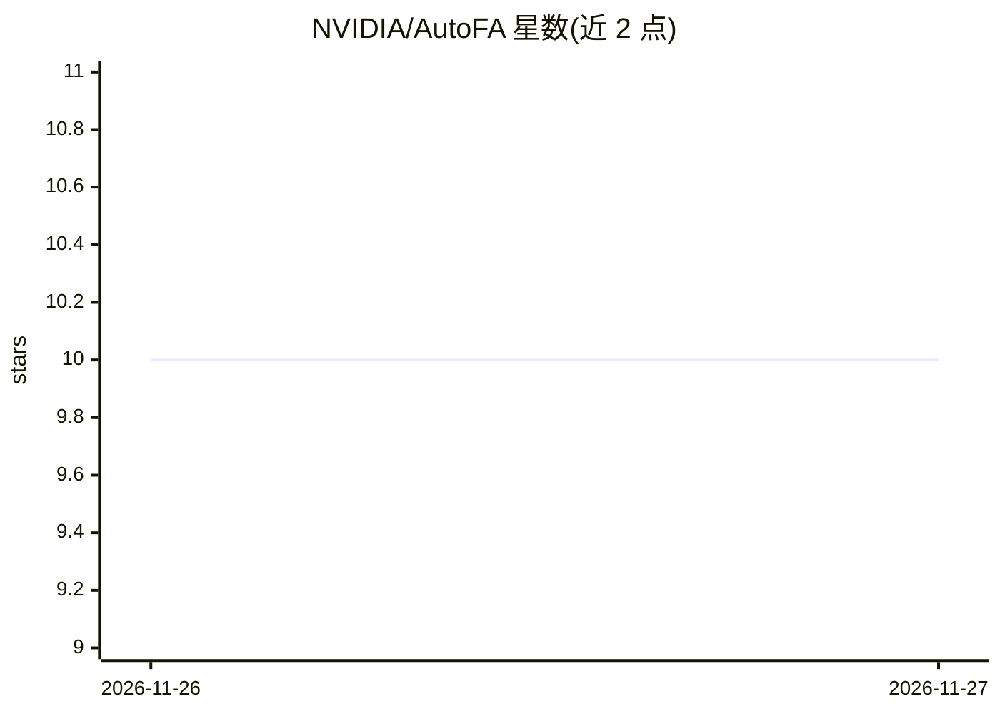

# NVIDIA/AutoFA

⭐ 10 · Python · NOASSERTION · 推送 2026-11-26 · [GitHub](https://github.com/NVIDIA/AutoFA) · 组织维护

**面向 agent 评测运行的自动化失败分析工具包**

NVIDIA AutoFA 读取已完成的评测运行（本地 NeMo Gym、Harbor 目录或远程 EvalRDL），从两个互补角度解释失败：自底向上的失败发现（由编码代理挖掘轨迹、生成可复用 Python 检测器并度量覆盖率）与自顶向下的分类法标注（用 LLM/代理裁判归入固定失败模式），并支持作弊预检、效率指标对比与本地失败库浏览发布。通过 Claude Code/Codex 代理驱动或终端交互菜单运行。处于 research preview，输出未经审查可能不准确，检测器执行无操作系统级沙箱。

## 筛选速览

| 维度 | 判定 | 备注 |
|---|---|---|
| AI 角色 | `ai-ecosystem` | LLM/agent 周边工具 |
| 许可风险 | `none` | NOASSERTION |
| 部署形态 | `None` |  |
| 模型依赖 | — | README 未给出锁定关系 |
| 硬件要求 | — | 无带数字的原话,不猜 |
| 安装摩擦 | `medium` | 含编译或系统依赖之一 |
| 成熟度 | `idea` | |

## 能力要点

- 自底向上失败发现生成可复用 Python 检测器并度量覆盖与证据
- 自顶向下分类法标注区分模型故障与 harness 故障
- preflight 作弊检查标记刷分/篡改评分器的 rollout
- 本地失败库浏览失败卡片、源轨迹与证据，支持发布与复用

## 适用场景

- 分析 agent 评测日志中反复出现的失败机制
- 按固定分类法统计各失败模式在运行中的分布
- 对比正确与错误 rollout 的 token、轮次与成本差异
- 通过编码代理委托完成分析流程的搭建与运行

## 场景标签

`模型评测` · 领域:评测与运维

## 证据(README 行号)

> L3: **Automated failure analysis for models and agent harnesses.**
> L13: A reward tells you *that* an agent failed, not *why*. AutoFA is a toolkit for
> L103: LLM judges and LLM detectors use an OpenAI-compatible endpoint that you configure

## 星数曲线

2026-11-26 10 → 2026-11-27 10（+0）

---
*卡片 v1 · prompt 1.4 · 生成 2026-11-26 · 置信度 high · 依据 README sha `9e4e3a313110` · [字段定义](../../DATASET.md)*
