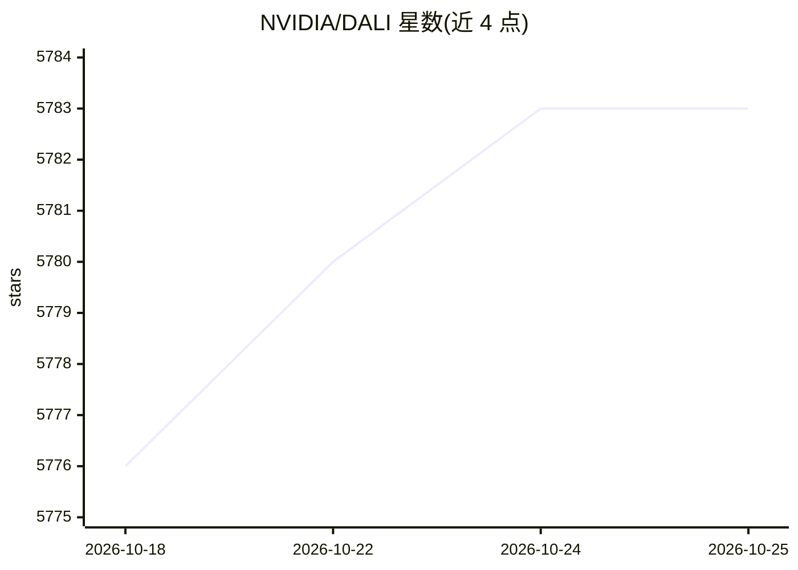

# NVIDIA/DALI

⭐ 5,784 · C++ · Apache-2.0 · 推送 2026-10-23 · [GitHub](https://github.com/NVIDIA/DALI) · [官网](https://docs.nvidia.com/deeplearning/dali/user-guide/docs/index.html) · 组织维护

**面向深度学习训练与推理的 GPU 加速数据加载与预处理库**

NVIDIA 维护的 GPU 加速数据处理库：提供加载、解码、裁剪、缩放及多种数据增强算子，覆盖图像、视频与音频；自带执行引擎，将 CPU 上的预处理卸载到 GPU，透明处理预取、并行执行与批处理。管线可在 TensorFlow、PyTorch、PaddlePaddle、JAX 之间移植，可作为框架内置数据加载器的替换。通过 pip 安装，需要 NVIDIA 驱动与 CUDA Toolkit；也预装于 NGC 容器。

## 筛选速览

| 维度 | 判定 | 备注 |
|---|---|---|
| AI 角色 | `ai-ecosystem` | LLM/agent 周边工具 |
| 许可风险 | `permissive` | Apache-2.0 |
| 部署形态 | `library` | 以包/库形式分发 |
| 模型依赖 | — | README 未给出锁定关系 |
| 硬件要求 | — | 无带数字的原话,不猜 |
| 安装摩擦 | `medium` | 含编译或系统依赖之一 |
| 成熟度 | — | 结构信号不足 |

## 能力要点

- 图像/视频/音频多格式支持（LMDB、TFRecord、COCO、JPEG、WAV、H.264 等）
- 自有执行引擎：预取、并行执行、批处理对用户透明
- 跨 TensorFlow/PyTorch/PaddlePaddle/JAX 移植的数据管线
- 支持 GPUDirect Storage 与 Triton 推理服务器集成

## 适用场景

- 训练/推理管线中替换 CPU 数据加载器以消除预处理瓶颈
- 跨框架复用同一套数据预处理管线
- 多 GPU 规模下加速图像分类、目标检测与 ASR 数据吞吐

## 场景标签

`图像视频处理` · 领域:感知与多模态

## 证据(README 行号)

> L9: image, video and audio data. It can be used as a portable drop-in replacement
> L25: can easily be retargeted to TensorFlow, PyTorch, and PaddlePaddle.
> L167: - Portable across popular deep learning frameworks: TensorFlow, PyTorch, PaddlePaddle, JAX.

## 星数曲线

2026-10-18 5,776 → 2026-10-25 5,783（+7）

---
*卡片 v1 · prompt 1.4 · 生成 2026-10-20 · 置信度 mid · 依据 README sha `e2f3f18c5e46` · [字段定义](../../DATASET.md)*
