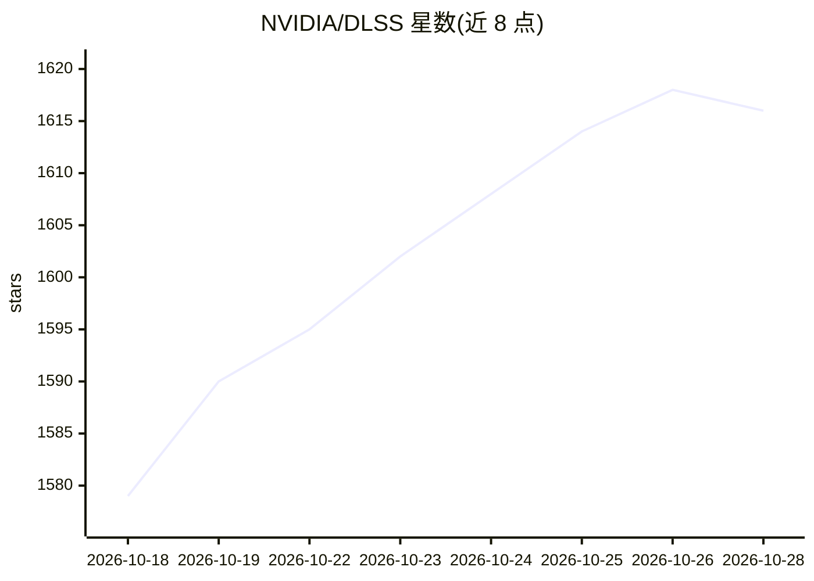

# NVIDIA/DLSS

⭐ 1,616 · C · NOASSERTION · 推送 2026-10-16 · [GitHub](https://github.com/NVIDIA/DLSS) · 组织维护

**NVIDIA DLSS SDK：深度学习超分辨率与帧生成的游戏图形 SDK**

NVIDIA RTX DLSS SDK 的公开仓库，面向游戏与图形开发者集成 DLSS 深度学习神经网络，用于提升帧率并生成图像；DLSS 示例应用仅随 releases 分发。仓库同时关联 NVIDIA Image Scaling SDK 子模块，提供跨平台的空间缩放与锐化算法（DX11/DX12/Vulkan 计算着色器），需通过 git clone --recurse-submodules 拉取子模块。SDK 本体为闭源分发，仓库不含模型实现代码。

## 筛选速览

| 维度 | 判定 | 备注 |
|---|---|---|
| AI 角色 | `ai-native` | 本体是模型或模型工具 |
| 许可风险 | `none` | NOASSERTION |
| 部署形态 | `None` |  |
| 模型依赖 | — | README 未给出锁定关系 |
| 硬件要求 | — | 无带数字的原话,不猜 |
| 安装摩擦 | `low` | 无编译、无系统依赖或容器化 |
| 成熟度 | — | 结构信号不足 |

## 能力要点

- DLSS 深度学习神经网络 SDK，用于提升帧率与图像生成
- 关联 NVIDIA Image Scaling SDK 子模块（DX11/DX12/Vulkan 计算着色器）
- DLSS Sample 应用仅随 releases 提供

## 适用场景

- 游戏引擎中集成 DLSS 超分辨率与帧生成功能
- 跨平台接入 NVIDIA Image Scaling 的空间缩放与锐化算法

## 场景标签

`图像视频处理` · 领域:感知与多模态

## 证据(README 行号)

> L1: # DLSS
> L2: Public repo for NVIDIA RTX DLSS SDK.

## 星数曲线

2026-10-18 1,579 → 2026-10-28 1,616（+37）

---
*卡片 v1 · prompt 1.4 · 生成 2026-10-21 · 置信度 high · 依据 README sha `3aa1394855dc` · [字段定义](../../DATASET.md)*
