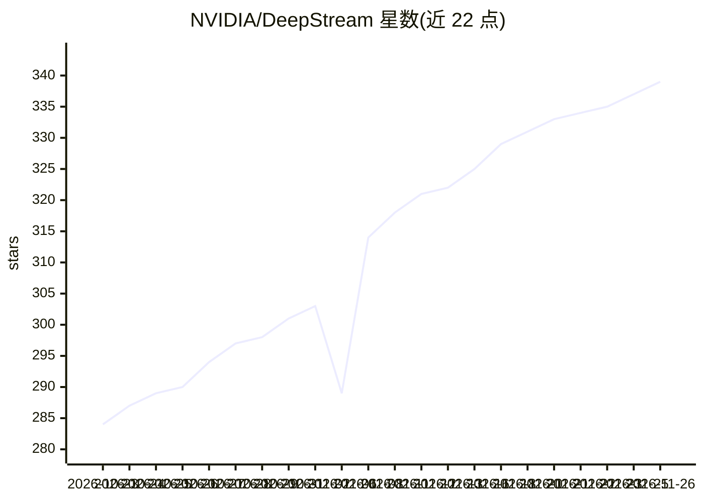

# NVIDIA/DeepStream

⭐ 339 · C++ · NOASSERTION · 推送 2026-11-24 · [GitHub](https://github.com/NVIDIA/DeepStream) · [官网](https://docs.nvidia.com/metropolis/deepstream/dev-guide/) · 组织维护

**NVIDIA 的 GPU 加速视频分析推理流水线开发 SDK**

基于 GStreamer 的流式分析工具包，用于在 NVIDIA GPU（dGPU 与 Jetson）上构建多路视频、多模型推理流水线，组合硬件编解码、TensorRT 推理、目标跟踪与消息代理集成。提供 C/C++ 示例与参考应用、TAO 模型集成应用、Service Maker C++/Python SDK、可视化流水线构建工具、相机自动标定，以及供 Claude Code 等编码助手使用的 agent skills。x86 提供 Ubuntu 24.04 下的源码构建与 .deb/tar 包，SBSA 仅支持 Docker 容器运行。

## 筛选速览

| 维度 | 判定 | 备注 |
|---|---|---|
| AI 角色 | `ai-ecosystem` | LLM/agent 周边工具 |
| 许可风险 | `none` | NOASSERTION |
| 部署形态 | `desktop` | 安装包/桌面程序 |
| 模型依赖 | — | README 未给出锁定关系 |
| 硬件要求 | — | 无带数字的原话,不猜 |
| 安装摩擦 | `low` | 无编译、无系统依赖或容器化 |
| 成熟度 | — | 结构信号不足 |

## 能力要点

- GStreamer 多路多模型推理流水线（解码、TensorRT 推理、跟踪、消息代理集成）
- 附 YOLO/SAM2 工具、可视化 inference builder 与相机自动标定工具
- 提供 Claude Code 编码助手技能集（流水线生成、性能剖析、模型导入等）
- 官方 Triton Docker 镜像与跨 x86/Jetson/IGX 平台支持

## 适用场景

- 在 GPU 上搭建实时多路视频目标检测与跟踪流水线
- 将 TAO 训练的检测/分类/分割模型部署到边缘设备
- 通过 Kafka 发布视频分析结果到下游服务

## 场景标签

`目标检测` · 领域:感知与多模态

## 证据(README 行号)

> L3: NVIDIA DeepStream SDK is a streaming analytics toolkit for AI-based video and image understanding, providing a GStre
> L5: DeepStream pipelines combine hardware-accelerated decoding/encoding, TensorRT inference, object tracking, and messag
> L20: - `src/service-maker/` — Service Maker C++/Python SDK and apps

## 星数曲线

2026-10-23 284 → 2026-11-26 339（+55）

---
*卡片 v1 · prompt 1.4 · 生成 2026-11-25 · 置信度 high · 依据 README sha `8a5a2da41205` · [字段定义](../../DATASET.md)*
