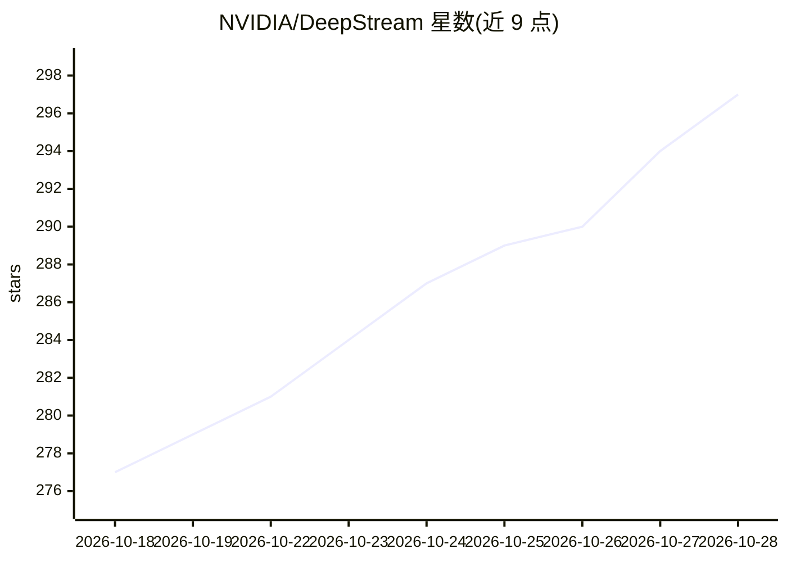

# NVIDIA/DeepStream

⭐ 297 · C++ · NOASSERTION · 推送 2026-10-27 · [GitHub](https://github.com/NVIDIA/DeepStream) · [官网](https://docs.nvidia.com/metropolis/deepstream/dev-guide/) · 组织维护

**面向开发者的 GPU 实时视频/多传感器 AI 分析流水线 SDK**

NVIDIA 维护的流式分析工具包：基于 GStreamer 构建多路流、多模型推理流水线，组合硬件加速编解码、TensorRT 推理、目标跟踪与消息代理集成，运行于 dGPU 与 Jetson 平台。仓库包含 DeepStream 9.2 全部源码（GStreamer 插件、示例与参考应用、Service Maker SDK）、推理流水线可视化构建等工具，以及面向 Claude Code 等 coding agent 的技能集。构建需 NVIDIA 计算栈（驱动/CUDA/cuDNN/TensorRT），SBSA/DGX Spark 仅支持容器方式；许可为文档 CC-BY-4.0、源码 Apache-2.0，不接受代码贡献。

## 筛选速览

| 维度 | 判定 | 备注 |
|---|---|---|
| AI 角色 | `ai-native` | 本体是模型或模型工具 |
| 许可风险 | `none` | NOASSERTION |
| 部署形态 | `desktop` | 安装包/桌面程序 |
| 模型依赖 | — | README 未给出锁定关系 |
| 硬件要求 | — | 无带数字的原话,不猜 |
| 安装摩擦 | `low` | 无编译、无系统依赖或容器化 |
| 成熟度 | — | 结构信号不足 |

## 能力要点

- GStreamer 框架构建多流多模型推理流水线，覆盖 dGPU/Jetson/边缘/云
- 组合硬件加速编解码、TensorRT 推理、目标跟踪与消息代理集成
- 提供 Triton Inference Server Docker 镜像与 NGC 容器
- 附 18 个 AI coding agent 技能与可视化 Inference Builder 工具

## 适用场景

- 构建多路摄像头的实时目标检测与跟踪系统
- 在 Jetson 边缘设备上部署视觉 AI 推理流水线
- 将 TAO 训练模型集成到视频分析应用
- 用 AI 编码助手生成与调试 DeepStream 流水线

## 场景标签

`图像视频处理` `目标检测` `推理引擎` · 领域:感知与多模态

## 证据(README 行号)

> L3: NVIDIA DeepStream SDK is a streaming analytics toolkit for AI-based video and image understanding, providing a GStre
> L5: DeepStream pipelines combine hardware-accelerated decoding/encoding, TensorRT inference, object tracking, and messag

## 星数曲线

2026-10-18 277 → 2026-10-28 297（+20）

---
*卡片 v1 · prompt 1.4 · 生成 2026-10-22 · 置信度 high · 依据 README sha `cc52f99909d1` · [字段定义](../../DATASET.md)*
