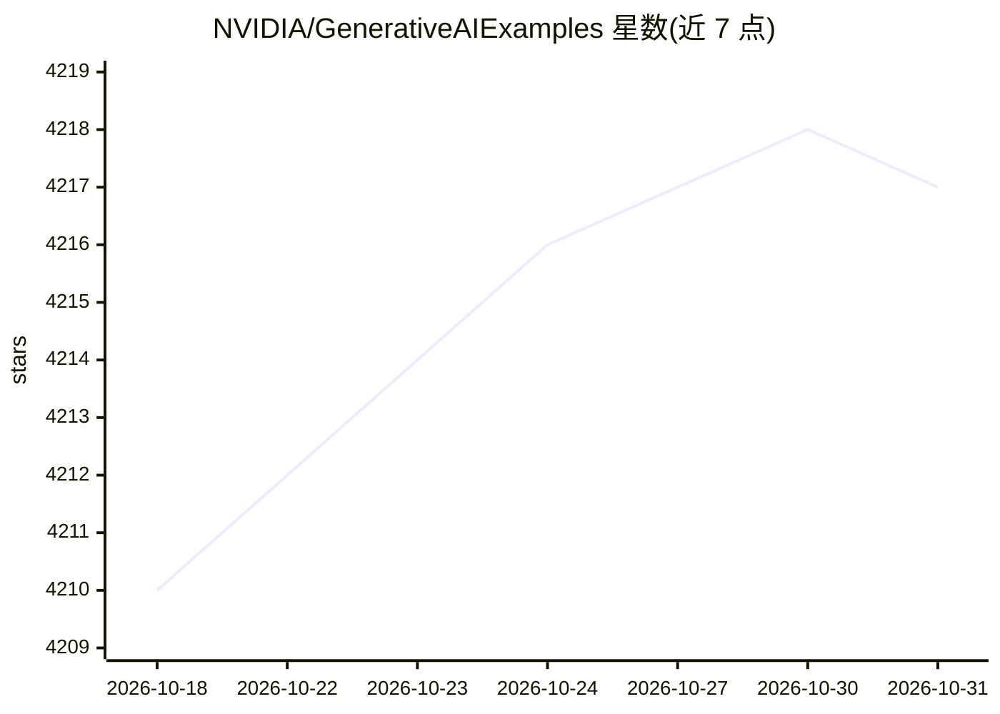

# NVIDIA/GenerativeAIExamples

⭐ 4,217 · Jupyter Notebook · Apache-2.0 · 推送 2026-09-09 · [GitHub](https://github.com/NVIDIA/GenerativeAIExamples) · 组织维护

**NVIDIA 生成式 AI 参考工作流集合：加速构建 RAG 与 Agentic 应用**

面向开发者的生成式 AI 示例仓库，提供基于 NVIDIA 软件生态（NIM 微服务、NeMo Microservices、TensorRT、Triton）的端到端参考工作流与 Jupyter notebook：涵盖基础与高级 RAG（多轮、多模态、结构化数据、查询分解）、Agentic 工作流（Llama 3.1、工具调用）、知识图谱 RAG、Data Flywheel（微调-推理-评测-护栏）、模型安全审计（NeMo Auditor）与视觉 NIM 工作流。默认使用 NVIDIA API Catalog 的预览 NIM 端点，需获取 NVIDIA API key，也可本地部署；基本 RAG 管线通过 docker compose 启动并附带 RAG Playground Web 界面。

## 筛选速览

| 维度 | 判定 | 备注 |
|---|---|---|
| AI 角色 | `ai-ecosystem` | LLM/agent 周边工具 |
| 许可风险 | `permissive` | Apache-2.0 |
| 部署形态 | `self-host` | docker 或自建部署 |
| 模型依赖 | — | README 未给出锁定关系 |
| 硬件要求 | — | 无带数字的原话,不猜 |
| 安装摩擦 | `low` | 无编译、无系统依赖或容器化 |
| 成熟度 | — | 结构信号不足 |

## 能力要点

- 基础/高级 RAG 参考管线，docker compose 一键启动并带 Playground Web 界面
- Data Flywheel 工作流：NeMo 微服务的微调、推理、评测与护栏
- 兼容 LangChain、LlamaIndex、Haystack 开发框架的连接器示例
- 视觉 NIM 工作流（VLM 监控、NV-CLIP 图像搜索、NVDINOv2 少样本分类）

## 适用场景

- 基于 NVIDIA NIM 微服务搭建 RAG 问答系统
- 为 LLM 应用添加工具调用与护栏（guardrails）能力
- 用 NeMo 微服务工作流做模型微调、评测与数据飞轮迭代
- 用 VLM/CLIP 模型构建视频监控与图像搜索应用

## 场景标签

`RAG` `Agent 框架` `知识图谱` `微调` · 领域:Agent 开发

## 证据(README 行号)

> L3: This repository is a starting point for developers looking to integrate with the NVIDIA software ecosystem to speed 
> L79:    docker compose up -d --build
> L104: NVIDIA has first-class support for popular generative AI developer frameworks like LangChain, LlamaIndex, and Hays

## 星数曲线

2026-10-18 4,210 → 2026-10-31 4,217（+7）

---
*卡片 v1 · prompt 1.4 · 生成 2026-10-20 · 置信度 high · 依据 README sha `55cd2d331813` · [字段定义](../../DATASET.md)*
