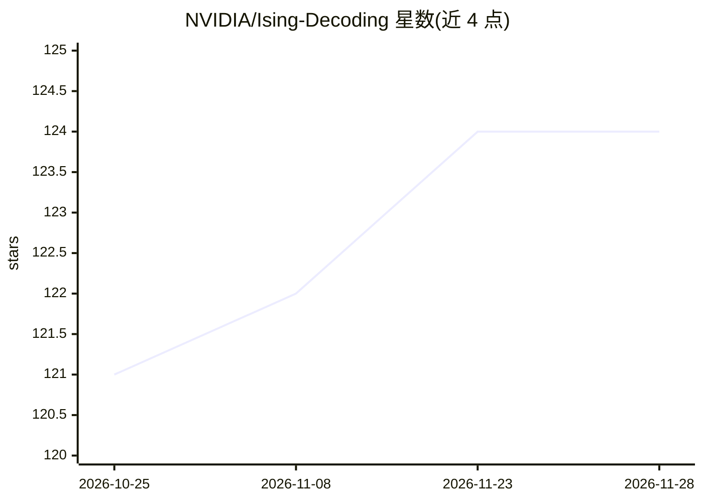

# NVIDIA/Ising-Decoding

⭐ 124 · Python · Apache-2.0 · 推送 2026-11-23 · [GitHub](https://github.com/NVIDIA/Ising-Decoding) · [官网](https://developer.nvidia.com/ising) · 组织维护

**为量子纠错解码器提供 AI 训练配方与预训练模型**

该仓库提供构建、定制和部署可扩展量子纠错解码器的 AI 训练配方：神经网络读取跨空间和时间的探测子综合征，预测降低综合征密度的修正，再由全局解码器（表面码用 PyMatching，色码用 Chromobius）产生最终逻辑判定。支持 surface 和 color 两种码族，共用一个配置文件和一个运行脚本；预训练模型以 fp16 SafeTensors 发布在 Hugging Face（需 token 访问授权），并支持导出 ONNX 与 INT8/FP8 量化。

## 筛选速览

| 维度 | 判定 | 备注 |
|---|---|---|
| AI 角色 | `ai-native` | 本体是模型或模型工具 |
| 许可风险 | `permissive` | Apache-2.0 |
| 部署形态 | `self-host` | docker 或自建部署 |
| 模型依赖 | — | README 未给出锁定关系 |
| 硬件要求 | — | 无带数字的原话,不猜 |
| 安装摩擦 | `low` | 无编译、无系统依赖或容器化 |
| 成熟度 | — | 结构信号不足 |

## 能力要点

- 神经网络跨空间和时间读取探测子综合征并预测修正
- 两种码族共用单一公开配置（conf/config_public.yaml）与单一运行脚本
- 预训练模型发布于 Hugging Face，支持 .pt 到 SafeTensors 转换及 ONNX/量化导出
- 推理时可更改码距与轮数而无需重新训练

## 适用场景

- 为表面码/色码实验训练或下载预训练的 AI 预解码器
- 对量子电路级噪声模拟数据运行推理评估逻辑错误率
- 导出量化模型用于部署管线

## 场景标签

`模型训练` `模型量化` · 领域:训练与推理

## 证据(README 行号)

> L12: This repo offers AI training recipes to build, customize and deploy scalable quantum error correction **decoders**:
> L15: - It predicts corrections that reduce syndrome density / improve decoding

## 星数曲线

2026-10-25 121 → 2026-11-28 124（+3）

---
*卡片 v1 · prompt 1.4 · 生成 2026-11-28 · 置信度 mid · 依据 README sha `d28f3bab5ecf` · [字段定义](../../DATASET.md)*
