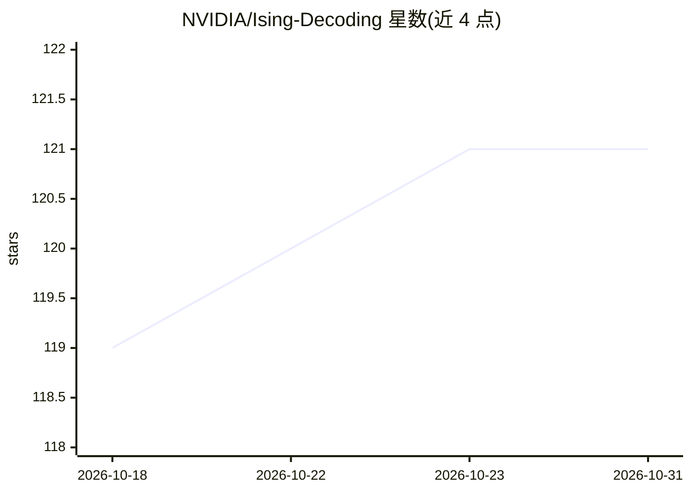

# NVIDIA/Ising-Decoding

⭐ 121 · Python · Apache-2.0 · 推送 2026-10-30 · [GitHub](https://github.com/NVIDIA/Ising-Decoding) · [官网](https://developer.nvidia.com/ising) · 组织维护

**量子纠错解码器的神经网络预解码训练方案**

NVIDIA 发布的 AI 量子纠错预解码器训练与推理方案：用 3D 卷积神经网络跨时空读取探测器症状、预测降低症状密度的修正，再由全局解码器（表面码 PyMatching、颜色码 Chromobius）给出最终逻辑判决。支持表面码与颜色码两个码族，共用单一用户配置与运行脚本；预训练模型以 fp16 SafeTensors 形式发布在 Hugging Face（访问需 token）。训练路径依赖 CUDA 与 cuStabilizer 后端，可导出 ONNX 并做 INT8/FP8 量化。

## 筛选速览

| 维度 | 判定 | 备注 |
|---|---|---|
| AI 角色 | `ai-native` | 本体是模型或模型工具 |
| 许可风险 | `permissive` | Apache-2.0 |
| 部署形态 | `self-host` | docker 或自建部署 |
| 模型依赖 | — | README 未给出锁定关系 |
| 硬件要求 | — | 无带数字的原话,不猜 |
| 安装摩擦 | `low` | 无编译、无系统依赖或容器化 |
| 成熟度 | — | 结构信号不足 |

## 能力要点

- 3D 卷积网络跨时空预测修正，衔接 PyMatching/Chromobius 全局解码器
- 表面码与颜色码共用单一配置文件与运行脚本
- 预训练模型发布于 Hugging Face，训练模型可导出 ONNX 并量化
- 推理时可变更码距与轮数，无需重新训练

## 适用场景

- 训练量子纠错的神经网络预解码器
- 用预训练模型直接运行解码推理评估逻辑错误率
- 将解码模型导出为 ONNX 并量化部署

## 场景标签

`模型训练` · 领域:训练与推理

## 证据(README 行号)

> L12: This repo offers AI training recipes to build, customize and deploy scalable quantum error correction **decoders**:
> L14: - A neural network consumes detector syndromes across space **and** time
> L15: - It predicts corrections that reduce syndrome density / improve decoding

## 星数曲线

2026-10-18 119 → 2026-10-31 121（+2）

---
*卡片 v1 · prompt 1.4 · 生成 2026-10-23 · 置信度 mid · 依据 README sha `b78a0168c748` · [字段定义](../../DATASET.md)*
