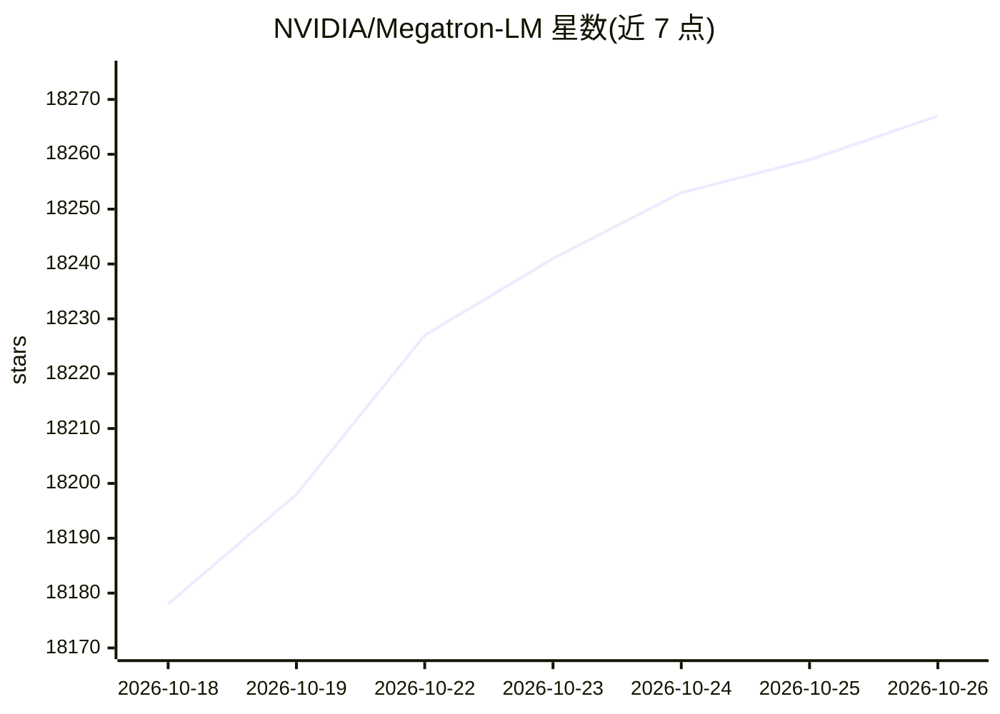

# NVIDIA/Megatron-LM

⭐ 18,267 · Python · NOASSERTION · 推送 2026-10-25 · [GitHub](https://github.com/NVIDIA/Megatron-LM) · [官网](https://docs.nvidia.com/megatron-core/developer-guide/latest/get-started/quickstart.html) · 组织维护

**面向研究团队的大规模 transformer 模型分布式训练库**

NVIDIA 维护的大规模 transformer 训练代码库，含两个组件：Megatron-LM 提供预配置训练脚本，供研究团队学习分布式训练与快速实验；Megatron Core 提供可组合的 GPU 优化构建块，含 TP/PP/DP/EP/CP 并行策略、FP16/BF16/FP8/FP4 混合精度与多种模型架构，供框架开发者搭建自定义训练流水线。提供 2B 到 462B 参数模型的基准测试结果与 Hugging Face 双向 checkpoint 转换工具 Megatron Bridge。即将发布的 0.17.0 版本将停止支持 Python 3.10。

## 筛选速览

| 维度 | 判定 | 备注 |
|---|---|---|
| AI 角色 | `ai-native` | 本体是模型或模型工具 |
| 许可风险 | `none` | NOASSERTION |
| 部署形态 | `library` | 以包/库形式分发 |
| 模型依赖 | locked-api |  |
| 硬件要求 | — | 无带数字的原话,不猜 |
| 安装摩擦 | `low` | 无编译、无系统依赖或容器化 |
| 成熟度 | `idea` | |

## 动量与使用信号

- 维护:`active` — 距上次 push 0.6 天,年发版 19,343 位贡献者
- 涨星:近 1 天 **+11**(自 20261016 起算)
- 安装:pypi 包 `megatron-core` 月下载 357,313

## 能力要点

- 五种并行策略（TP、PP、DP、EP、CP）与 FP16/BF16/FP8/FP4 混合精度支持
- 基准测试覆盖 2B 至 462B 参数模型、数千 GPU 规模
- Megatron Bridge 提供 Hugging Face 与 Megatron checkpoint 双向转换
- MoE 模型训练配置与 checkpoint 转换工具（DeepSeek-V3、Mixtral、Qwen3）

## 适用场景

- 研究团队学习分布式训练并快速开展实验
- 框架开发者用 Megatron Core 构建自定义训练流水线
- 在数千 GPU 上训练大型语言模型
- 与 Hugging Face 生态互转 checkpoint

## 场景标签

`模型训练` · 领域:训练与推理

## 证据(README 行号)

> L13: **Megatron-LM** is a reference example that includes Megatron Core plus pre-configured training scripts, ideal for 
> L15: **Megatron Core** is a composable library with GPU-optimized building blocks for custom training frameworks. It pro
> L75: The codebase efficiently trains models from 2B to 462B parameters across thousands of GPUs, achieving up to **47% M

## 星数曲线

2026-10-18 18,178 → 2026-10-26 18,267（+89）

---
*卡片 v1 · prompt 1.4 · 生成 2026-10-18 · 置信度 high · 依据 README sha `db376b25e8bc` · [字段定义](../../DATASET.md)*
